# 1MM-DB-01 · Schemas

|              |                                                                                                                                                                                                                                                                       |
| ------------ | --------------------------------------------------------------------------------------------------------------------------------------------------------------------------------------------------------------------------------------------------------------------- |
| **Document** | 1MM-DB-01                                                                                                                                                                                                                                                             |
| **Status**   | Approved baseline · v1.0 · 24 Nov 2026                                                                                                                                                                                                                                |
| **Audience** | Engineers and coding agents                                                                                                                                                                                                                                           |
| **Owner**    | Engineering lead (code owners)                                                                                                                                                                                                                                        |
| **Sources**  | [SQL] (`packages/db/migrations/0001_baseline_v3_4.sql`), `packages/db/migrations/0006_partition_function_definer.sql`, `packages/db/roles/roles.sql`, `packages/db/src/*`, [DD §1–§15], [TR §10.1], [TR §10.2], [TR §4.3], [TR §11], [DDR]                            |
| **Related**  | [1MM-DB-02](1MM-DB-02-MIGRATIONS.md), [1MM-DB-03](1MM-DB-03-SQL-STRUCTURE.md), [1MM-DB-04](1MM-DB-04-INDEXING.md), [1MM-DB-05](1MM-DB-05-SECURITY.md), [1MM-DB-06](1MM-DB-06-DATA-PROTECTION.md), [1MM-STD-15](../standards/1MM-STD-15-DATA-STRUCTURES-AND-MODELS.md) |

**What this document is for and when to open it.** It is the map of the database: the engine, the
namespaces, every table by domain with its owning execution module, the keys, the types, the
partitions, the views and the seeds. Open it before you model a table in `packages/db/src/schema/`,
before you write a module's data inventory, and before you propose any schema change (the change
itself follows [1MM-DB-02](1MM-DB-02-MIGRATIONS.md)).

## 1. How the numbers in this document were counted

Every count below was produced by a script over
`packages/db/migrations/0001_baseline_v3_4.sql` on 24 Nov 2026, not copied from prose. Migration
`0006` adds no object (it alters one function).

| Object                  | Count                                 | How it was counted                                                                                                                                                                                                                                                                                                 |
| ----------------------- | ------------------------------------- | ------------------------------------------------------------------------------------------------------------------------------------------------------------------------------------------------------------------------------------------------------------------------------------------------------------------ |
| Tables                  | 221                                   | Lines matching `CREATE TABLE` (230) minus the 9 `... PARTITION OF ... DEFAULT` lines                                                                                                                                                                                                                               |
| Partitioned tables      | 9                                     | Lines containing `PARTITION BY`                                                                                                                                                                                                                                                                                    |
| Enum types              | 101                                   | Lines matching `^CREATE TYPE ... AS ENUM` (there is no other `CREATE TYPE`)                                                                                                                                                                                                                                        |
| Domains                 | 6                                     | Lines matching `^CREATE DOMAIN`                                                                                                                                                                                                                                                                                    |
| Sequences (explicit)    | 14                                    | Lines matching `^CREATE SEQUENCE`                                                                                                                                                                                                                                                                                  |
| Views                   | 13                                    | Lines matching `^CREATE VIEW`                                                                                                                                                                                                                                                                                      |
| Materialised views      | 6                                     | Lines matching `^CREATE MATERIALIZED VIEW`                                                                                                                                                                                                                                                                         |
| Functions               | 40                                    | Lines matching `^CREATE OR REPLACE FUNCTION`                                                                                                                                                                                                                                                                       |
| Triggers                | 101                                   | 73 `CREATE [CONSTRAINT] TRIGGER` statements (4 of them constraint triggers) plus 28 created by the loop in section 18.3 of the file: 10 `trg_<table>_workflow`, 10 `trg_<table>_snapshot`, 8 `trg_<table>_wf_upd` (the loop skips `help_articles` and `site_pages`, which already have a `set_updated_at` trigger) |
| Row-level security      | 10 tables, 14 policies                | `ENABLE ROW LEVEL SECURITY` and `CREATE POLICY` lines                                                                                                                                                                                                                                                              |
| `COMMENT ON` statements | 339 (221 on tables, 58 on columns)    | Lines matching `COMMENT ON`; the section 18.3 loop adds column comments at run time                                                                                                                                                                                                                                |
| Index statements        | 292 written out (49 of them `UNIQUE`) | Lines matching `CREATE [UNIQUE] INDEX`; the total including partitions and loop-created indexes is 1,085 [DD changelog]. Detail: [1MM-DB-04](1MM-DB-04-INDEXING.md)                                                                                                                                                |
| Seed rows               | see section 11                        | A parser that counts the top-level tuples of each `INSERT ... VALUES` in section 24 of the file                                                                                                                                                                                                                    |

These agree with the totals published for schema v3.4 [TR §10.1], [DD changelog]. The trigger
total is not published in the sources; 101 is this document's count.

**After migration `0007`** (`0007_trx_schema_change_set.sql`, schema change set 0007 of
[1MM-LOG-03](../1MM-LOG-03-TECHNICAL-REFERENCE-EXTENSIONS.md)). The migration adds no table,
column, type, view, trigger or function. What changed was counted on 24 Nov 2026 by catalogue
queries (`pg_class`, `pg_inherits`, `pg_proc`, `pg_policies`, and the two seed tables) against one
PostgreSQL 16 database migrated to `0006` and one migrated to `0007`:

| Object                                 | At `0006`              | At `0007`              | What changed                                                                                                |
| -------------------------------------- | ---------------------- | ---------------------- | ----------------------------------------------------------------------------------------------------------- |
| Tables                                 | 221                    | 221                    | none                                                                                                        |
| Partitions (monthly and default)       | 121                    | 135                    | 14 monthly partitions of `edge_security_events`                                                             |
| Functions                              | 40                     | 40                     | 4 re-created (`record_reaction`, `undo_reaction`, `decide_intro`, `unmatch`), 1 altered (`is_blocked_pair`) |
| `SECURITY DEFINER` functions           | 2                      | 6                      | The four matching functions                                                                                 |
| Row-level security                     | 10 tables, 14 policies | 10 tables, 14 policies | `profiles_read` altered                                                                                     |
| Index statements written out           | 292                    | 304                    | 12 in `0007`                                                                                                |
| Indexes including partitions           | 1,085                  | 1,125                  | 12 new, and 28 on the new partitions (primary key and `idx_edge_events_rule` on each of 14)                 |
| CHECK constraints on `safety_checkins` | 3                      | 3                      | `safety_checkins_check` replaced by `ck_checkins_respond_by`                                                |
| `remote_config` keys                   | 86                     | 97                     | 11 new keys; 4 existing keys updated (bounds on 2, `is_public` on 2); public keys 41 → 47                   |
| `worker_jobs` rows                     | 66                     | 70                     | 4 new rows; `cron` set on 4 rows (none before)                                                              |

## 2. Engine and extensions

| Item                | Value                                                                                                                                                                             | Source                                     |
| ------------------- | --------------------------------------------------------------------------------------------------------------------------------------------------------------------------------- | ------------------------------------------ |
| Engine              | PostgreSQL 16                                                                                                                                                                     | [TR §4.3], [SQL] preamble                  |
| Hosted              | Neon serverless PostgreSQL 16, AWS eu-central-1; staging is a separate Neon project, never a branch of production                                                                 | [TR §4.3], [OD-11]                         |
| Local and CI        | Docker image `postgis/postgis:16-3.4` (`docker-compose.yml`, `.github/workflows/ci.yml`)                                                                                          | repo                                       |
| Extensions          | `postgis` (geography columns, GiST distance search), `citext` (case-insensitive e-mail), `pgcrypto` (`digest()` for the audit hash chain, `gen_random_uuid()` inside `uuid_v7()`) | [SQL] `CREATE EXTENSION IF NOT EXISTS` × 3 |
| Session assumptions | `TimeZone = 'UTC'`; `timestamptz` everywhere. `createDatabase()` in `packages/db/src/client.ts` sets `TimeZone: 'UTC'` and an `application_name` on every connection              | [SQL] preamble, repo                       |
| Version guard       | The file avoids PostgreSQL 17+ features: its own `uuid_v7()` instead of the native `uuidv7()`                                                                                     | [DD verification], [SQL] conventions       |
| Scale-out           | Single primary. Citus only when writes exceed one primary; the plan is a comment block (section 25 of the file) and nothing in it runs on plain PostgreSQL                        | [TR §10.2], [TR §10.3]                     |

No other extension may be added without a Technical Reference extension: these three are "the only
extensions the schema needs" and all are available on Neon [TR §4.3].

## 3. Namespaces

| Namespace                  | What lives there                                                                                                                                                                                                                                                                        | Owner role                                      | Created by                                             |
| -------------------------- | --------------------------------------------------------------------------------------------------------------------------------------------------------------------------------------------------------------------------------------------------------------------------------------- | ----------------------------------------------- | ------------------------------------------------------ |
| `public`                   | All 221 application tables, the types, functions, views and materialised views; PostGIS objects                                                                                                                                                                                         | The migration role (group `app_migrator`)       | `pnpm db:migrate`                                      |
| `public.schema_migrations` | The migrator's bookkeeping table: `name text PRIMARY KEY`, `checksum text`, `applied_at timestamptz`. Not part of schema v3.4; created by `ensureLedger()` in `packages/db/src/migrator.ts`. `roles.sql` revokes every privilege on it from `app_api`, `app_admin_api` and `app_worker` | The migration role                              | The runner, on first use                               |
| `pgboss`                   | The pg-boss 12 queue tables. `apps/worker/src/main.ts` starts pg-boss with `createSchema: false` on `QUEUE_DATABASE_URL`; pg-boss manages its own tables inside the schema. Job payloads there are plain text: ids only, never secrets or personal data                                 | `app_queue`, which has no privilege on `public` | `pnpm db:roles` (`CREATE SCHEMA IF NOT EXISTS pgboss`) |

Rules:

1. Application objects go in `public` only. `drizzle.config.ts` introspects `schemaFilter: ['public']`.
2. Our migrations never create, alter or read objects in `pgboss`. The job catalogue the admin
   console shows is the application table `worker_jobs`; runtime state is in pg-boss [SQL].
3. `schema_migrations` is never written by hand (see [1MM-DB-02](1MM-DB-02-MIGRATIONS.md)).

Roles, grants and row-level security are specified in [1MM-DB-05](1MM-DB-05-SECURITY.md).

## 4. Domain map

The domains are those of the data dictionary [DD §1–§13]. Tables that the dictionary describes in
its version sections ([DD §13A.1], [DD §13B.1]) are placed in the domain those sections name. The
owning module is the primary owner from the module map of the execution plan
([1MM-EXE-00](../execution/1MM-EXE-00-MASTER-PLAN.md)); each module plan's data inventory (its
section 3.1) is authoritative for shared use. The Citus column is the distribution key noted in
the dictionary headings and in section 25 of the file; "reference" means a replicated reference
table, "coordinator-local" means it stays on the coordinator, "not stated" means the file names
no key for it.

| Domain [DD]                                        | Group                                                         | Tables                                                                                                                                                                                                                                                                                                                                              | n   | Owning module                                                                                                                                                                    | Citus key                                                                                                   |
| -------------------------------------------------- | ------------------------------------------------------------- | --------------------------------------------------------------------------------------------------------------------------------------------------------------------------------------------------------------------------------------------------------------------------------------------------------------------------------------------------- | --- | -------------------------------------------------------------------------------------------------------------------------------------------------------------------------------- | ----------------------------------------------------------------------------------------------------------- |
| 1. Reference catalogues (24)                       | Markets, options and text                                     | `countries`, `cities`, `languages`, `option_sets`, `options`, `vibe_tags`, `industries`, `prompts`, `i18n_strings`                                                                                                                                                                                                                                  | 9   | MOD-02                                                                                                                                                                           | reference                                                                                                   |
| 1. Reference catalogues (24)                       | Safety catalogues                                             | `report_reasons`, `decision_reasons`                                                                                                                                                                                                                                                                                                                | 2   | MOD-09                                                                                                                                                                           | reference                                                                                                   |
| 1. Reference catalogues (24)                       | Chat effects                                                  | `message_effects`                                                                                                                                                                                                                                                                                                                                   | 1   | MOD-08                                                                                                                                                                           | reference                                                                                                   |
| 1. Reference catalogues (24)                       | Venues                                                        | `venues`                                                                                                                                                                                                                                                                                                                                            | 1   | MOD-13                                                                                                                                                                           | reference                                                                                                   |
| 1. Reference catalogues (24)                       | Plans, entitlements, products and prices                      | `plans`, `entitlements`, `role_entitlements`, `products`, `prices`, `plan_compare_rows`                                                                                                                                                                                                                                                             | 6   | MOD-10 (read-only resolver in MOD-03, ruling R2)                                                                                                                                 | reference                                                                                                   |
| 1. Reference catalogues (24)                       | Notification catalogue                                        | `notification_categories`, `notification_templates`                                                                                                                                                                                                                                                                                                 | 2   | MOD-11                                                                                                                                                                           | reference                                                                                                   |
| 1. Reference catalogues (24)                       | Legal documents                                               | `legal_documents`                                                                                                                                                                                                                                                                                                                                   | 1   | MOD-16                                                                                                                                                                           | reference                                                                                                   |
| 1. Reference catalogues (24)                       | Help centre                                                   | `help_categories`, `help_articles`                                                                                                                                                                                                                                                                                                                  | 2   | MOD-14                                                                                                                                                                           | reference                                                                                                   |
| 2. Identity and auth (14)                          | Accounts, credentials, devices, sessions                      | `users`, `password_credentials`, `oauth_identities`, `phone_numbers`, `devices`, `sessions`, `refresh_tokens`, `otp_challenges`, `login_attempts`, `account_lockouts`, `password_resets`, `new_device_challenges`, `age_gate_blocks`, `role_history`                                                                                                | 14  | MOD-03                                                                                                                                                                           | `user_id`                                                                                                   |
| 3. Profile (14)                                    | Profile, media, prompts, preferences                          | `profiles`, `nickname_history`, `profile_languages`, `profile_answers`, `prompt_answers`, `media_assets`, `profile_media`, `partner_preferences`, `partner_preference_options`, `partner_preference_sections`, `partner_preference_languages`                                                                                                       | 11  | MOD-04                                                                                                                                                                           | `user_id`                                                                                                   |
| 3. Profile (14)                                    | Vibes                                                         | `profile_vibes`                                                                                                                                                                                                                                                                                                                                     | 1   | MOD-06 (ruling R3)                                                                                                                                                               | `user_id`                                                                                                   |
| 3. Profile (14)                                    | International countries                                       | `international_countries`                                                                                                                                                                                                                                                                                                                           | 1   | MOD-10 (ruling R3)                                                                                                                                                               | `user_id`                                                                                                   |
| 3. Profile (14)                                    | App settings                                                  | `user_settings`                                                                                                                                                                                                                                                                                                                                     | 1   | MOD-03 (ruling R3)                                                                                                                                                               | `user_id`                                                                                                   |
| 4. Verification (8)                                | Black Badge                                                   | `badge_applications`, `verification_records`, `liveness_sessions`, `face_templates`, `carrier_checks`                                                                                                                                                                                                                                               | 5   | MOD-06                                                                                                                                                                           | `user_id`                                                                                                   |
| 4. Verification (8)                                | Paywall and upgrade flows                                     | `pending_actions`, `upgrade_progress`, `safety_briefing_acks`                                                                                                                                                                                                                                                                                       | 3   | MOD-06 and MOD-10 (`pending_actions`), MOD-04 and MOD-10 (`upgrade_progress`), MOD-10 (`safety_briefing_acks`, ruling R21)                                                       | `user_id`                                                                                                   |
| 5. Discovery and matching (11)                     | Deck, reactions, matches, Spotlight                           | `usage_counters`, `feed_impressions`, `reactions`, `reaction_history`, `pair_cooldowns`, `hidden_profiles`, `matches`, `spotlight_rotations`                                                                                                                                                                                                        | 8   | MOD-07                                                                                                                                                                           | `user_id` / `actor_id`; pair tables `user_a`                                                                |
| 5. Discovery and matching (11)                     | 1-Minute Intro                                                | `intro_sessions`, `intro_messages`, `intro_decisions`                                                                                                                                                                                                                                                                                               | 3   | MOD-08                                                                                                                                                                           | `user_a`                                                                                                    |
| 6. Messaging (10)                                  | Chats, Direct Specs, calls                                    | `conversations`, `conversation_participants`, `messages`, `message_client_ids`, `message_attachments`, `message_reactions`, `message_failures`, `dm_requests`, `calls`, `call_feedback`                                                                                                                                                             | 10  | MOD-08                                                                                                                                                                           | `conversation_id`                                                                                           |
| 7. Groups (6)                                      | Groups                                                        | `groups`, `group_rules`, `group_members`, `group_invites`, `group_messages`, `group_message_reactions`                                                                                                                                                                                                                                              | 6   | MOD-12                                                                                                                                                                           | `group_id`                                                                                                  |
| 8. Meet-ups and safety (10)                        | Meet-ups, trusted contacts, check-ins, escalations            | `meetups`, `meetup_rsvps`, `meetup_time_proposals`, `meetup_feedback`, `trusted_contacts`, `trusted_contact_messages`, `meetup_shares`, `safety_checkins`, `safety_escalations`, `safety_escalation_updates`                                                                                                                                        | 10  | MOD-13                                                                                                                                                                           | `meetup_id`; trusted contacts `user_id`                                                                     |
| 9. Trust and safety (18)                           | Blocks, reports, cases, sanctions, appeals, abuse rules, risk | `blocks`, `reports`, `report_evidence`, `moderation_cases`, `moderation_case_watchers`, `moderation_actions`, `account_restrictions`, `appeals`, `appeal_evidence`, `age_verification_requests`, `abuse_rules`, `abuse_rule_hits`, `risk_devices`, `risk_ips`, `identity_links`, `trust_signals`                                                    | 16  | MOD-09                                                                                                                                                                           | `blocks` by `blocker_id`; `abuse_rules` reference; others not stated                                        |
| 9. Trust and safety (18)                           | Forced re-verification                                        | `reverification_requests`                                                                                                                                                                                                                                                                                                                           | 1   | MOD-05                                                                                                                                                                           | `user_id`                                                                                                   |
| 9. Trust and safety (18)                           | Account deletion                                              | `account_deletions`                                                                                                                                                                                                                                                                                                                                 | 1   | MOD-16                                                                                                                                                                           | not stated                                                                                                  |
| 10. Billing (20)                                   | Customers, subscriptions, payments, grants, reconciliation    | `billing_customers`, `subscriptions`, `subscription_events`, `trials`, `transactions`, `invoices`, `refunds`, `disputes`, `entitlement_grants`, `billing_credits`, `lapse_choices`, `webhook_events`, `payment_methods`, `reconciliation_runs`, `reconciliation_items`, `payouts`                                                                   | 16  | MOD-10                                                                                                                                                                           | `user_id`; `webhook_events`, `reconciliation_runs`, `payouts` coordinator-local                             |
| 10. Billing (20)                                   | Offers (off at launch, OD-01)                                 | `offer_campaigns`, `offer_code_pools`, `offer_codes`, `offer_claims`                                                                                                                                                                                                                                                                                | 4   | MOD-10                                                                                                                                                                           | coordinator-local                                                                                           |
| 11. Notifications, support, legal and privacy (16) | Notifications and communications                              | `push_tokens`, `notification_preferences`, `notifications`, `inbox_items`, `email_suppressions`, `broadcast_campaigns`, `in_app_announcements`, `feature_waitlist`                                                                                                                                                                                  | 8   | MOD-11                                                                                                                                                                           | `user_id`; broadcasts and announcements coordinator-local                                                   |
| 11. Notifications, support, legal and privacy (16) | Support and feedback                                          | `support_tickets`, `support_messages`, `help_article_votes`, `feedback`                                                                                                                                                                                                                                                                             | 4   | MOD-14                                                                                                                                                                           | not stated                                                                                                  |
| 11. Notifications, support, legal and privacy (16) | Consent and privacy                                           | `consent_records`, `data_export_requests`, `privacy_requests`, `legal_holds`                                                                                                                                                                                                                                                                        | 4   | MOD-16                                                                                                                                                                           | `user_id`; `legal_holds` coordinator-local                                                                  |
| 12. Analytics and research (10)                    | Events, research, saved reports                               | `analytics_events`, `research_studies`, `research_tasks`, `research_participants`, `research_sessions`, `research_task_results`, `research_findings`, `analytics_saved_reports`, `scheduled_exports`, `store_installs_daily`                                                                                                                        | 10  | MOD-18                                                                                                                                                                           | `analytics_events`, `store_installs_daily` coordinator-local; saved reports and scheduled exports reference |
| 13. Admin console and platform (60)                | Admin access and governance                                   | `admin_users`, `admin_mfa_factors`, `admin_recovery_codes`, `admin_trusted_devices`, `admin_permissions`, `admin_roles`, `admin_role_permissions`, `admin_user_roles`, `admin_sessions`, `admin_login_attempts`, `admin_security_alerts`, `admin_approvals`, `admin_audit_log`, `admin_audit_chain_runs`, `admin_exports`                           | 15  | MOD-01                                                                                                                                                                           | reference, except `admin_audit_log` and `admin_exports` (coordinator-local)                                 |
| 13. Admin console and platform (60)                | Console shell                                                 | `admin_notifications`, `admin_saved_views`                                                                                                                                                                                                                                                                                                          | 2   | MOD-00 (A04 stage B)                                                                                                                                                             | `admin_notifications` coordinator-local; `admin_saved_views` reference                                      |
| 13. Admin console and platform (60)                | Macros                                                        | `admin_macros`                                                                                                                                                                                                                                                                                                                                      | 1   | MOD-09 (safety), MOD-14 (support)                                                                                                                                                | reference                                                                                                   |
| 13. Admin console and platform (60)                | Platform configuration                                        | `feature_flags`, `feature_flag_overrides`, `remote_config`, `app_versions`, `maintenance_windows`, `rate_limit_policies`, `vendor_settings`, `vendor_health_checks`, `worker_jobs`                                                                                                                                                                  | 9   | MOD-02 (`worker_jobs` runtime in MOD-00)                                                                                                                                         | reference (`feature_flags`, `remote_config`, `rate_limit_policies`, `vendor_settings`, `worker_jobs`)       |
| 13. Admin console and platform (60)                | Network and security operations                               | `ip_access_rules`, `api_request_rollups`, `api_request_samples`, `api_request_ip_rollups`, `edge_security_events`, `security_detections`, `security_incidents`                                                                                                                                                                                      | 7   | MOD-17                                                                                                                                                                           | coordinator-local                                                                                           |
| 13. Admin console and platform (60)                | Website CMS                                                   | `media_library`, `site_pages`, `site_blocks`, `site_page_sections`, `stories`, `story_consents`, `careers_jobs`, `investor_documents`, `investor_document_grants`, `press_items`, `faqs`, `journal_categories`, `journal_authors`, `journal_articles`, `content_revisions`, `redirects`, `site_settings`, `cms_publish_runs`, `web_redirects_daily` | 19  | MOD-15                                                                                                                                                                           | coordinator-local (`site_settings`, `journal_categories` reference)                                         |
| 13. Admin console and platform (60)                | Website forms                                                 | `contact_submissions`, `job_applications`, `newsletter_subscribers`, `web_uploads`, `waitlist_entries`, `beta_invites`, `consent_receipts`                                                                                                                                                                                                          | 7   | MOD-15 builds the A29 views (ruling R24); rows: MOD-14 (`contact_submissions`, `web_uploads`), MOD-11 (`newsletter_subscribers`), MOD-16 (`consent_receipts`), MOD-15 (the rest) | coordinator-local                                                                                           |

Totals: 24 + 14 + 14 + 8 + 11 + 10 + 6 + 10 + 18 + 20 + 16 + 10 + 60 = **221**.

Module documents: MOD-00 [Foundations](../execution/1MM-EXE-MOD-00-FOUNDATIONS.md), MOD-01
[Admin access](../execution/1MM-EXE-MOD-01-ADMIN-ACCESS-AND-GOVERNANCE.md), MOD-02
[Platform config](../execution/1MM-EXE-MOD-02-PLATFORM-CONFIG-AND-CATALOGUES.md), MOD-03
[Identity](../execution/1MM-EXE-MOD-03-MEMBER-IDENTITY-AND-AUTH.md), MOD-04
[Profile](../execution/1MM-EXE-MOD-04-PROFILE-MEDIA-AND-PROMPTS.md), MOD-05
[Member administration](../execution/1MM-EXE-MOD-05-MEMBER-ADMINISTRATION.md), MOD-06
[Black Badge](../execution/1MM-EXE-MOD-06-BLACK-BADGE-VERIFICATION.md), MOD-07
[Discovery](../execution/1MM-EXE-MOD-07-DISCOVERY-AND-MATCHING.md), MOD-08
[Intro and chat](../execution/1MM-EXE-MOD-08-INTRO-CHAT-AND-DIRECT-SPECS.md), MOD-09
[Trust and safety](../execution/1MM-EXE-MOD-09-TRUST-AND-SAFETY.md), MOD-10
[Billing](../execution/1MM-EXE-MOD-10-BILLING-PLANS-AND-ENTITLEMENTS.md), MOD-11
[Notifications](../execution/1MM-EXE-MOD-11-NOTIFICATIONS-AND-COMMUNICATIONS.md), MOD-12
[Groups](../execution/1MM-EXE-MOD-12-GROUPS.md), MOD-13
[Meet-ups](../execution/1MM-EXE-MOD-13-MEETUPS-AND-PERSONAL-SAFETY.md), MOD-14
[Support](../execution/1MM-EXE-MOD-14-SUPPORT-AND-HELP.md), MOD-15
[CMS and website](../execution/1MM-EXE-MOD-15-CMS-AND-PUBLIC-WEBSITE.md), MOD-16
[Legal and privacy](../execution/1MM-EXE-MOD-16-LEGAL-PRIVACY-AND-DATA-OPERATIONS.md), MOD-17
[Network and security](../execution/1MM-EXE-MOD-17-NETWORK-AND-SECURITY-OPERATIONS.md), MOD-18
[Analytics](../execution/1MM-EXE-MOD-18-ANALYTICS-OVERVIEW-AND-RESEARCH.md).

## 5. Entity relationships by domain

Each diagram shows the core tables of a domain and their foreign keys. Every relationship was
confirmed by extracting the `REFERENCES` clauses of each `CREATE TABLE` block and the `ALTER TABLE
... ADD FOREIGN KEY` statements (sections 19 and 18.5 of the file). A label is the referencing
column. `||--o{` reads "one to many"; `||--o|` reads "one to at most one" (the child's primary key
is the foreign key).

Three things hold everywhere and are not repeated in the diagrams:

- Almost every member-owned table references `users(id)`; 166 foreign keys are `ON DELETE
CASCADE`, 195 `ON DELETE SET NULL`, 16 `ON DELETE RESTRICT` (line counts in the file).
- Admin attribution columns (`created_by`, `updated_by`, `approved_by`, `decided_by`, `admin_id`)
  reference `admin_users(id)`.
- Columns named `approval_id` reference `admin_approvals(id)` (four-eyes).

### 5.1 Identity and auth

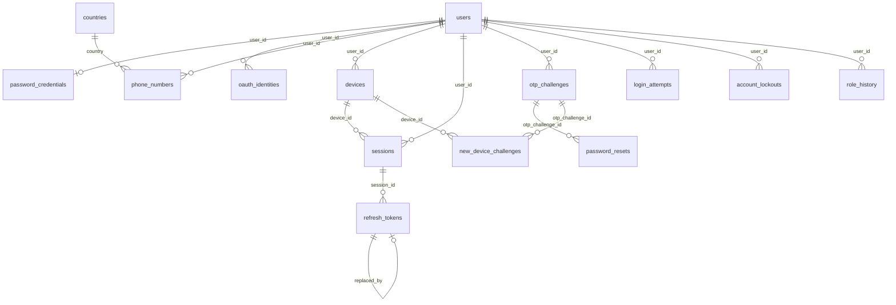

`age_gate_blocks` has no foreign key: its key is a device hash (`sha256_hash`).

### 5.2 Profile and verification

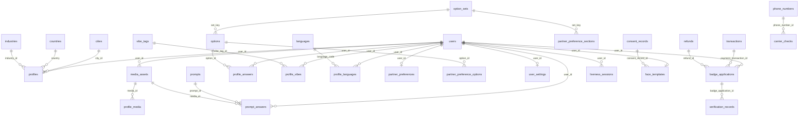

### 5.3 Discovery, matching and the 1-Minute Intro

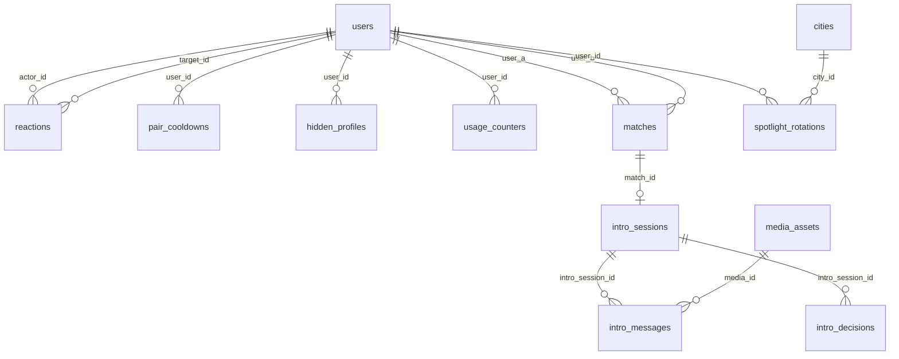

`feed_impressions` and `reaction_history` carry no foreign keys by design (high-volume, append-only)
[SQL] table comments. `intro_sessions.match_id` is unique, which is why `record_reaction()` can
insert it `ON CONFLICT (match_id) DO NOTHING` (see [1MM-DB-03](1MM-DB-03-SQL-STRUCTURE.md)).

### 5.4 Messaging

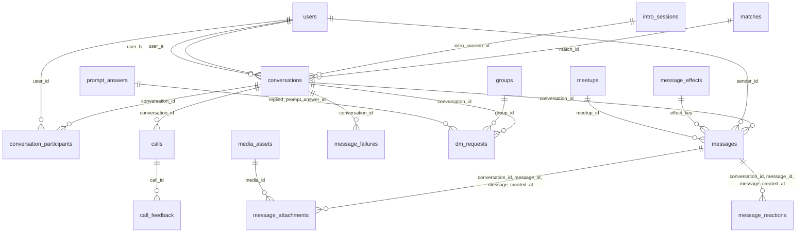

`messages` is partitioned, so its primary key is `(conversation_id, id, created_at)` and children
reference all three columns. `message_client_ids` has no foreign key: it is the idempotency ledger
for sends, because a unique key cannot span a partitioned table [TR §10.2].

### 5.5 Groups

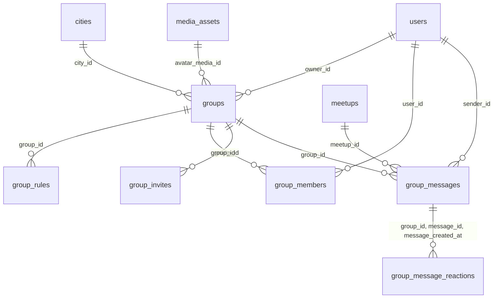

### 5.6 Meet-ups and personal safety

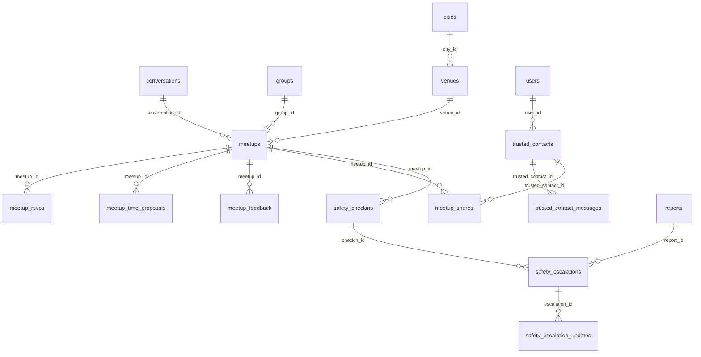

### 5.7 Trust and safety

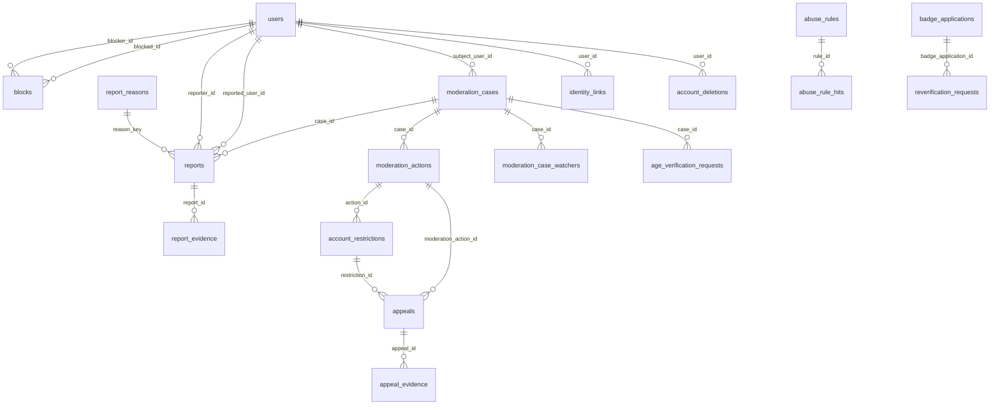

### 5.8 Billing and offers

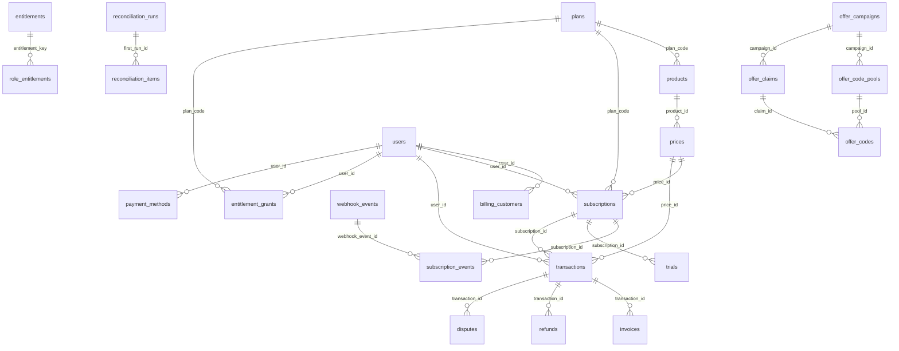

### 5.9 Notifications, support, legal and privacy

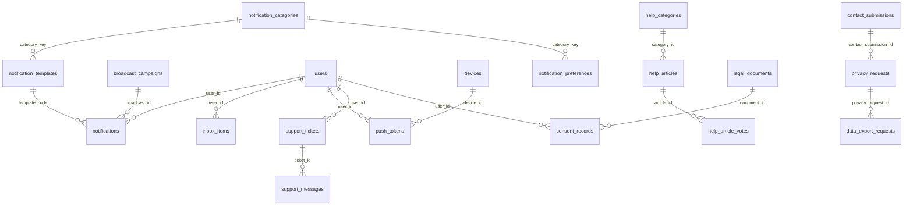

`notifications.user_id` is nullable: since v3.4 a notification can go to a non-member
(`recipient_kind`, encrypted address and hash) [SQL] changelog.

### 5.10 Admin access and platform

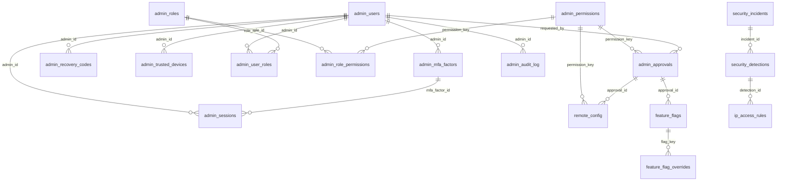

The request-log tables (`api_request_rollups`, `api_request_samples`, `api_request_ip_rollups`,
`edge_security_events`, `vendor_health_checks`) and `worker_jobs` have no foreign keys.

### 5.11 Website CMS and forms

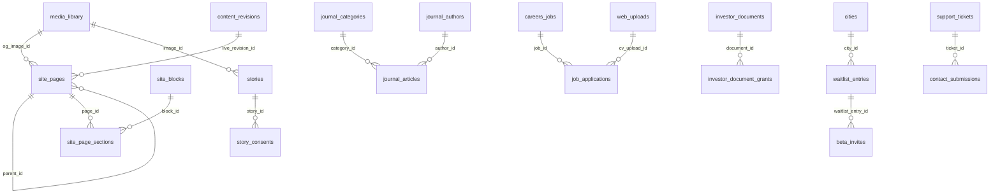

`live_revision_id` exists on all ten workflow tables returned by `content_workflow_tables()`
(`site_pages`, `site_blocks`, `stories`, `careers_jobs`, `investor_documents`, `press_items`,
`help_articles`, `legal_documents`, `faqs`, `journal_articles`) and is the only deferrable foreign
key in the schema. `content_revisions.entity_id` is text and has no foreign key, so one history
table serves tables with uuid and text keys [SQL].

### 5.12 Analytics and research

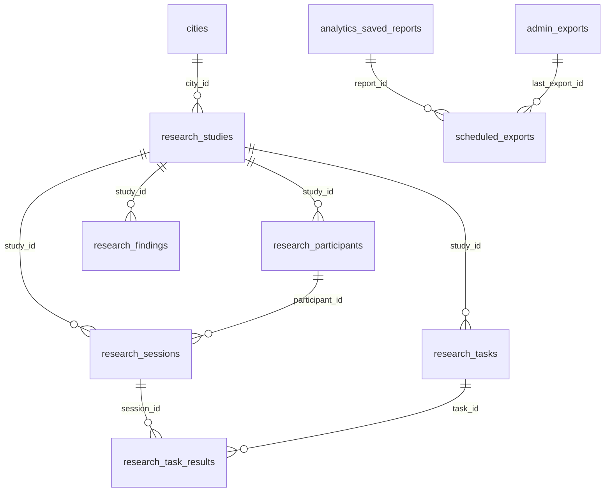

`analytics_events` has no foreign keys (append-only, partitioned).

## 6. Keys

| Kind of table                            | Primary key                                                                                                                                | Count | Example                                                                                                                                                  |
| ---------------------------------------- | ------------------------------------------------------------------------------------------------------------------------------------------ | ----- | -------------------------------------------------------------------------------------------------------------------------------------------------------- |
| Entity rows                              | `id uuid PRIMARY KEY DEFAULT uuid_v7()`                                                                                                    | 138   | `users`, `matches`, `transactions`                                                                                                                       |
| One-to-one extension of a member         | `user_id uuid PRIMARY KEY REFERENCES users(id)`                                                                                            | 5     | `password_credentials`, `profiles`, `partner_preferences`, `user_settings`, `face_templates`                                                             |
| Link and counter tables                  | Composite primary key                                                                                                                      | 41    | `profile_vibes (user_id, vibe_tag_id)`, `usage_counters (user_id, metric, period_start)`                                                                 |
| Catalogues and config with a natural key | `text` (15), `smallint` identity (7), `integer` identity (1), `iso_country` (1), `plan_t` (1), `citext` (1), `inet` (1), `sha256_hash` (2) | 29    | `remote_config.key`, `options.id`, `cities.id`, `countries.iso2`, `plans.code`, `email_suppressions.email`, `risk_ips.ip`, `age_gate_blocks.device_hash` |
| Append-only logs nothing references      | `bigint GENERATED ALWAYS AS IDENTITY`                                                                                                      | 8     | `login_attempts`, `role_history`, `reaction_history`, `subscription_events`                                                                              |

The counts come from parsing the primary-key line of each `CREATE TABLE` block; they sum to 221.
Partitioned tables are among the composite keys because the partition key must be part of the key.

`uuid_v7(p_ts timestamptz DEFAULT clock_timestamp())` builds an RFC 9562 version 7 UUID: a 48-bit
Unix millisecond timestamp followed by random bits from `gen_random_uuid()`. Why it is the rule
[SQL] conventions, [TR §10.2]:

- unique across Citus shards and across devices: the member app's offline outbox generates ids on
  the phone;
- time-ordered, so B-tree inserts stay local like a `bigint`;
- not guessable in URLs.

Rules for new tables:

1. An entity table takes `id uuid PRIMARY KEY DEFAULT uuid_v7()`. Do not use `gen_random_uuid()`
   as a default and do not use `serial`.
2. A small catalogue takes a natural `text` key or a `smallint` identity.
3. A table that is one row per member takes `user_id` as its primary key.
4. A partitioned table includes the partition column in its primary key and in every unique index.
5. A human-readable reference (R-, S-, W-, SR-, SE-, A-, RF-, PR-, LH-, SI-, J-) is a separate
   column fed by a named sequence (`refund_ref_seq`, `appeal_ref_seq`, `report_public_ref_seq`,
   `support_ticket_ref_seq`, `contact_public_ref_seq` and the others in section 1 of the file); it
   is never the primary key.

## 7. Type system

### 7.1 Enum types (101)

Enums hold stable state machines; anything an admin edits is a catalogue table, not an enum
("stable state machines; catalogues are tables", section 2 of the file). Every enum name ends in
`_t`. Values are lower snake case, except `member_role_t`, whose values are the upper-case role
names `BASIC`, `PENDING_REVIEW`, `ACTIVE`, `CLASSIC`, `SUPER`.

| Domain                    | Enum types                                                                                                                                                                                                                           | n   |
| ------------------------- | ------------------------------------------------------------------------------------------------------------------------------------------------------------------------------------------------------------------------------------ | --- |
| Member, account and auth  | `member_role_t`, `plan_t`, `account_status_t`, `signup_path_t`, `oauth_provider_t`, `platform_t`, `otp_purpose_t`, `otp_channel_t`, `lock_subject_t`, `device_answer_t`, `phone_type_t`                                              | 11  |
| Profile and media         | `gender_t`, `interest_t`, `intention_t`, `presence_t`, `theme_t`, `media_kind_t`, `media_status_t`, `face_match_t`, `moderation_status_t`, `prompt_answer_kind_t`                                                                    | 10  |
| Verification              | `verification_kind_t`, `verification_result_t`, `badge_status_t`, `badge_step_t`, `carrier_result_t`                                                                                                                                 | 5   |
| Discovery and matching    | `reaction_t`, `feed_surface_t`, `cooldown_reason_t`, `match_kind_t`, `match_status_t`, `intro_status_t`, `intro_decision_t`, `usage_metric_t`                                                                                        | 8   |
| Messaging and calls       | `conversation_kind_t`, `conversation_state_t`, `message_kind_t`, `safety_verdict_t`, `send_failure_t`, `dm_kind_t`, `dm_status_t`, `call_kind_t`, `call_status_t`, `feeling_t`                                                       | 10  |
| Groups                    | `group_join_rule_t`, `group_post_rule_t`, `group_status_t`, `group_role_t`, `group_member_status_t`, `invite_status_t`                                                                                                               | 6   |
| Meet-ups and safety       | `meetup_kind_t`, `meetup_status_t`, `meetup_join_rule_t`, `rsvp_status_t`, `trusted_status_t`, `checkin_status_t`, `escalation_kind_t`                                                                                               | 7   |
| Trust and safety          | `report_subject_t`, `report_context_t`, `report_status_t`, `case_kind_t`, `case_status_t`, `moderation_action_t`, `restriction_kind_t`, `appeal_status_t`, `deletion_status_t`, `rule_kind_t`, `rule_action_t`                       | 11  |
| Billing                   | `payment_provider_t`, `product_kind_t`, `billing_interval_t`, `subscription_status_t`, `subscription_event_t`, `transaction_kind_t`, `transaction_status_t`, `pay_method_t`, `refund_reason_t`, `dispute_status_t`, `grant_source_t` | 11  |
| Notifications and support | `notif_channel_t`, `delivery_status_t`, `ticket_status_t`, `ticket_channel_t`, `author_kind_t`                                                                                                                                       | 5   |
| Legal and privacy         | `consent_kind_t`, `consent_action_t`, `legal_doc_kind_t`, `export_status_t`, `privacy_request_t`                                                                                                                                     | 5   |
| Admin and platform        | `admin_status_t`, `mfa_kind_t`, `approval_status_t`, `scope_kind_t`, `actor_kind_t`, `list_kind_t`, `maintenance_kind_t`                                                                                                             | 7   |
| Analytics and research    | `task_outcome_t`                                                                                                                                                                                                                     | 1   |
| Website and CMS           | `content_status_t`, `contact_kind_t`, `subscriber_status_t`, `web_safety_category_t`                                                                                                                                                 | 4   |

Notes that affect code:

- `plan_t` has exactly three values: `free`, `premium`, `gold`. Black Badge is a one-off product
  (`product_kind_t` `one_off`), never a plan [TR §2.1].
- `payment_provider_t` keeps `stripe` and `pay_method_t` keeps `link` and `usdc` as legacy values
  that new code never writes; web billing is `flutterwave` [OD-14], [SQL].
- Enum values cannot be removed or reordered in place. Adding one is its own migration file
  ([1MM-DB-02](1MM-DB-02-MIGRATIONS.md) section 7.2).
- Many small closed sets are **not** enums but `text` columns with a `CHECK (col IN (...))`, for
  example `matches.ended_reason`, `reactions.undone_via`, `edge_security_events.action`. They are
  easier to change (drop and re-add the constraint) and are the pattern for sets that may grow.

### 7.2 Domains (6)

| Domain        | Base type and rule                | Used for                                                 |
| ------------- | --------------------------------- | -------------------------------------------------------- |
| `e164`        | `text`, `^\+[1-9][0-9]{6,14}$`    | Phone numbers                                            |
| `iso_country` | `char(2)`, two upper-case letters | Country codes; `countries.iso2` is the key               |
| `app_locale`  | `text`, one of `en`, `pcm`, `fr`  | Every locale column                                      |
| `usd_cents`   | `bigint`, `>= 0`                  | Money. List prices are USD only, stored as integer cents |
| `hex_colour`  | `text`, `#RRGGBB`                 | Plan tier colours                                        |
| `sha256_hash` | `bytea`, exactly 32 bytes         | Tokens, codes and identifiers stored hashed, never raw   |

Adding a fourth app language means altering the `app_locale` domain check in a migration; it is a
schema change, not a config change [SQL].

### 7.3 Composite types

There are none: the file has no `CREATE TYPE ... AS (...)`. Functions that return several values
use `RETURNS TABLE (...)` with `o_`-prefixed output columns (for example `record_reaction()`,
`spend_spec_view()`). **Recommendation:** keep it that way; a composite type adds an object to
migrate for no gain.

### 7.4 Other column types in use

| Type                               | Where                                                                                                                | Note                                                                                                                  |
| ---------------------------------- | -------------------------------------------------------------------------------------------------------------------- | --------------------------------------------------------------------------------------------------------------------- |
| `geography(Point, 4326)` (PostGIS) | `profiles.location`, `cities.centroid`, `venues.location`, `groups.location`, `safety_checkins.last_coarse_location` | Written as EWKT through `geographyPoint` in `packages/db/src/schema/types.ts`; read with `ST_X` / `ST_Y` in the query |
| `citext`                           | E-mail and other case-insensitive identifiers, for example `users.email`, `email_suppressions.email`                 | Custom type `citext` in `types.ts`                                                                                    |
| `jsonb`                            | Config values, rules, audit `before` / `after`, CMS block data                                                       | Parsed with a schema before use ([1MM-STD-16](../standards/1MM-STD-16-DEFENSIVE-PROGRAMMING.md))                      |
| `tsvector` generated column        | `help_articles.search_tsv`                                                                                           | `GENERATED ALWAYS AS (...) STORED`, GIN-indexed                                                                       |
| `inet`, `cidr`                     | IP addresses and prefixes                                                                                            | `risk_ips.ip`, `edge_security_events.ip_prefix`                                                                       |
| `bytea`                            | Hashes (`sha256_hash`), encrypted values, the audit chain                                                            | Custom type `bytea` in `types.ts`                                                                                     |

## 8. Naming conventions as used

These are the conventions the baseline actually follows; new objects must match them.

| Object                      | Convention                                                                                                                                                                                                                                                                                                                                                                                                      | Evidence                                                        |
| --------------------------- | --------------------------------------------------------------------------------------------------------------------------------------------------------------------------------------------------------------------------------------------------------------------------------------------------------------------------------------------------------------------------------------------------------------- | --------------------------------------------------------------- |
| Tables                      | `lower_snake_case`, plural (`users`, `matches`, `moderation_cases`). Link tables join the two nouns (`profile_vibes`, `admin_role_permissions`). Daily aggregates end in `_daily` (`store_installs_daily`, `web_redirects_daily`)                                                                                                                                                                               | 221 table names                                                 |
| Table prefixes              | A domain prefix groups related tables: `admin_`, `profile_`, `partner_preference_`, `message_`, `group_`, `meetup_`, `safety_`, `moderation_`, `offer_`, `site_`, `journal_`, `research_`, `api_request_`, `notification_`                                                                                                                                                                                      | [SQL]                                                           |
| Columns                     | `lower_snake_case`. Primary key `id`; foreign key `<singular>_id` (`user_id`, `match_id`), or the referenced natural key's name (`set_key`, `plan_code`, `country`, `permission_key`). Pair tables use `user_a` / `user_b` with `CHECK (user_a < user_b)`                                                                                                                                                       | `matches`, `conversations`, `intro_sessions`                    |
| Timestamps                  | `timestamptz`, past participle + `_at` (`created_at`, `updated_at`, `deleted_at`, `published_at`); deadlines `_until`, `_by`, `expires_at`, `_due_at` (`undo_until`, `respond_by`, `sla_due_at`); calendar days `_on` (`starts_on`) or `day`                                                                                                                                                                    | [SQL]                                                           |
| Booleans                    | `is_` / `has_` / `allows_` / `needs_` prefix or a plain adjective (`is_verified`, `allows_international`, `needs_consent`, `enabled`)                                                                                                                                                                                                                                                                           | [SQL]                                                           |
| Money                       | `<name>_usd_cents` of domain `usd_cents`                                                                                                                                                                                                                                                                                                                                                                        | `amount_usd_cents`, `fee_usd_cents`                             |
| Hashes and encrypted values | `<name>_hash` of domain `sha256_hash`; encrypted values `<name>_enc`                                                                                                                                                                                                                                                                                                                                            | `code_hash`, `fingerprint_hash`, `email_enc`, `totp_secret_enc` |
| Enum types                  | `<noun>_t`                                                                                                                                                                                                                                                                                                                                                                                                      | 101 of 101                                                      |
| Indexes                     | `idx_<table-or-abbreviation>_<purpose>` (243 statements); unique indexes `uq_<table-or-abbreviation>_<rule>` (49). Loop-created CMS indexes are `idx_<table>_wf_due`, `_wf_unpub`, `_wf_queue`, `_wf_tgroup`                                                                                                                                                                                                    | prefix counts over `CREATE [UNIQUE] INDEX`                      |
| Constraints                 | Most `CHECK`, `UNIQUE` and foreign keys are declared inline and keep PostgreSQL's generated names (`<table>_<column>_check`, `<table>_<column>_fkey`, `<table>_<columns>_key`). Constraints added by `ALTER TABLE` are named `ck_<table>_<rule>` (30 `CONSTRAINT ck_` occurrences plus the loop-created `ck_<table>_wf_window`, `_wf_scheduled`, `_wf_approved`, `_wf_published`, `_wf_archived`, `_wf_native`) | [SQL]                                                           |
| Triggers                    | `trg_<table-or-abbreviation>_<purpose>`: `_upd` for `set_updated_at`, `_immutable` for `forbid_mutation`, `_approval` for `enforce_config_approval`, `_max` for `enforce_max_children`, `_workflow`, `_snapshot`, `_slug`                                                                                                                                                                                       | 73 of 73 statements                                             |
| Functions                   | `lower_snake_case` verb phrases (`record_reaction`, `decide_intro`, `ensure_monthly_partitions`); trigger functions are named for the rule (`forbid_mutation`, `refund_approval_guard`). Parameters `p_`, locals `v_`, output columns `o_`                                                                                                                                                                      | 40 functions                                                    |
| Views                       | `v_<purpose>`; materialised views `mv_<purpose>` with a unique index `uq_mv_<name>`                                                                                                                                                                                                                                                                                                                             | 13 + 6                                                          |
| Sequences                   | `<purpose>_seq`; human-reference sequences `<thing>_ref_seq`                                                                                                                                                                                                                                                                                                                                                    | 14                                                              |
| RLS policies                | `<table-or-abbreviation>_<scope>` (`profiles_read`, `messages_send`, `inbox_own`)                                                                                                                                                                                                                                                                                                                               | 14                                                              |
| Partitions                  | `<parent>_pYYYYMM` and `<parent>_default`                                                                                                                                                                                                                                                                                                                                                                       | `ensure_monthly_partitions()`                                   |
| Config keys                 | Dotted lower snake case, domain first: `discovery.daily_cap.basic`, `intro.window_hours`                                                                                                                                                                                                                                                                                                                        | `remote_config` seed                                            |

**Recommendation (new constraints):** name every constraint a new migration adds
(`ck_<table>_<rule>`, `uq_<table>_<rule>`), because a later migration has to drop or validate it by
name. Inline unnamed constraints in the baseline keep their generated names.

Column conventions that apply to every mutable table [SQL] conventions:

1. `created_at timestamptz NOT NULL DEFAULT now()` and `updated_at`, with a `BEFORE UPDATE` trigger
   calling `set_updated_at()`.
2. Soft delete (`deleted_at`) only where the product offers undo or a retention rule requires it;
   hard erasure happens only in the erasure job ([1MM-DB-06](1MM-DB-06-DATA-PROTECTION.md)).
3. Every "only one" rule is a constraint or a unique index, not application logic.
4. Every table has a `COMMENT ON TABLE` that states purpose, screens, retention and PII class.

## 9. Reference tables and entity tables

|                  | Reference and catalogue tables                                                                                                                                                                  | Entity tables                                                  |
| ---------------- | ----------------------------------------------------------------------------------------------------------------------------------------------------------------------------------------------- | -------------------------------------------------------------- |
| What             | Data the product reads and an admin (or a migration) writes: markets, option lists, plans, prices, entitlements, templates, legal documents, config, flags, permissions, roles, job catalogue   | Data created by members, admins and jobs at run time           |
| Keys             | Natural `text` key or small identity                                                                                                                                                            | `uuid_v7()`                                                    |
| Rows at start    | Seeded in section 24 of the baseline (section 11 below)                                                                                                                                         | None: the baseline ships "reference data only; no member data" |
| Who changes them | The admin console, behind a permission and, for config, a four-eyes approval in production (`enforce_config_approval()`); or a migration                                                        | The APIs and the worker                                        |
| Citus            | `create_reference_table` (replicated to every node)                                                                                                                                             | Distributed by the key in section 4, or coordinator-local      |
| Caching          | Safe to cache; public values reach clients through the config bootstrap and the i18n catalogue                                                                                                  | Not cached, except where the Redis keyspace says so [DD §14]   |
| Foreign keys     | Entity tables reference catalogues (`profiles.city_id`, `reports.reason_key`, `subscriptions.plan_code`); catalogues do not reference entity tables, apart from admin attribution and approvals | –                                                              |

The file lists the reference set in section 25: the 22 tables of section 3 plus `abuse_rules`,
`remote_config`, `feature_flags`, `rate_limit_policies`, the `admin_*` tables other than the audit
log, `admin_notifications` and `admin_exports`, and from v3.1 `vendor_settings`, `worker_jobs`,
`site_settings`, `journal_categories`, `analytics_saved_reports`, `scheduled_exports`.

The owner's rule that nothing a person reads is hard-coded rests on these tables: a new limit is a
`remote_config` key, a new option is an `options` row, new wording is an `i18n_strings` key or a
template, never a constant in code.

## 10. Partitioned tables, views and materialised views

### 10.1 Partitioned tables (9)

All nine are `PARTITION BY RANGE` on a timestamp, monthly, with a `DEFAULT` partition as a safety
net [TR §10.2].

| Table                    | Partition key  | Primary key                                                             | Domain    |
| ------------------------ | -------------- | ----------------------------------------------------------------------- | --------- |
| `messages`               | `created_at`   | `(conversation_id, id, created_at)`                                     | Messaging |
| `group_messages`         | `created_at`   | `(group_id, id, created_at)`                                            | Groups    |
| `feed_impressions`       | `shown_at`     | `(user_id, shown_at, target_id)`                                        | Discovery |
| `analytics_events`       | `occurred_at`  | `(occurred_at, id)`                                                     | Analytics |
| `admin_audit_log`        | `created_at`   | `(created_at, id)`                                                      | Admin     |
| `api_request_rollups`    | `bucket_start` | `(bucket_start, route_key, method, status_class, platform, country)`    | Network   |
| `api_request_samples`    | `at`           | `(at, id)`                                                              | Network   |
| `api_request_ip_rollups` | `bucket_start` | `(bucket_start, ip_prefix, asn, country, route_key, user_agent_family)` | Network   |
| `edge_security_events`   | `occurred_at`  | `(occurred_at, id)`                                                     | Network   |

How partitions come to exist:

1. Section 23 of the baseline calls `ensure_monthly_partitions(t, DATE '2026-11-01', 14)` for
   eight of the nine parents, which creates `<parent>_p202611` to `<parent>_p202712`.
   `edge_security_events` is not in that call (GAP-DB01-01); migration `0007` makes the same call
   for it, so all nine parents now have `_p202611` to `_p202712`.
2. The worker job `partitions.ensure` (`apps/worker/src/jobs/partitions-ensure.ts`, cron
   `0 3 1 * *`) calls `ensure_monthly_partitions(table, current_date, 3)` for all nine tables.
   Migration `0006` makes the function `SECURITY DEFINER` with a pinned `search_path` so that
   `app_worker`, which has no DDL rights, can run exactly this one DDL action; `roles.sql` grants
   it `EXECUTE`.
3. `partitions.retain` (seeded in `worker_jobs`, monthly, destructive) detaches and archives
   partitions past retention [TR §11]. Retention periods are in
   [1MM-DB-06](1MM-DB-06-DATA-PROTECTION.md).

Consequences for code: a unique key on a partitioned table must contain the partition key, so
message idempotency lives in `message_client_ids` [TR §10.2]; children reference the full
composite key; the generated ids of `admin_audit_log`, `analytics_events` and
`api_request_samples` come from explicit sequences (`<table>_id_seq`).

### 10.2 Views (13)

| View                            | Purpose                                                                | Reader                                                     |
| ------------------------------- | ---------------------------------------------------------------------- | ---------------------------------------------------------- |
| `v_member_entitlements`         | Role, plan, restriction flag and the full entitlement map              | `GET /v1/me/entitlements`; cached in Redis `ent:{user_id}` |
| `v_role_drift`                  | Members whose cached role differs from the computed one; must be empty | Job `entitlements.reconcile` (hourly)                      |
| `v_chat_list`                   | Chats list rows                                                        | D8                                                         |
| `v_fresh_matches`               | Matches with no intro decision yet and hours left                      | D8, ES3                                                    |
| `v_likes_received`              | "Liked you" grid and its kind filter                                   | D7, D7F                                                    |
| `v_unread_counts`               | Tab badges and unread counts; cached in Redis `badge:{user_id}`        | Tab shell, D16, H7                                         |
| `v_current_consents`            | Latest consent state per member and kind                               | LG6                                                        |
| `v_admin_effective_permissions` | Every permission an active admin holds now, with scope                 | Admin authorisation on each request                        |
| `v_admin_mfa_gaps`              | Active admins without a confirmed MFA factor; must be empty            | Admin sign-in                                              |
| `v_research_summary`            | Usability scorecard against targets                                    | Admin research pages; granted to `app_readonly`            |
| `v_offer_pool_stock`            | Offer code pool totals and the low-water flag                          | A22                                                        |
| `v_content_queue`               | Items in review, approved or scheduled across the ten CMS tables       | A28 publishing                                             |
| `v_public_plan_prices`          | Current list prices and `trial_days` per product and provider          | Website plan blocks (W12, W22)                             |

Sources: the `COMMENT ON VIEW` of each object and [DD §13 "Views and materialized views"].

### 10.3 Materialised views (6)

Each has a unique index, which `REFRESH MATERIALIZED VIEW CONCURRENTLY` requires. The baseline
populates them once without `CONCURRENTLY` (end of section 24); every later refresh is concurrent
and is done by the worker job `stats.refresh` ("5-60 min", [TR §11]).

| Materialised view                | Unique index                                           | Refresh stated in its comment                          | Used by                                         |
| -------------------------------- | ------------------------------------------------------ | ------------------------------------------------------ | ----------------------------------------------- |
| `mv_admin_daily_kpis`            | `uq_mv_daily_kpis (day)`                               | Every 15 minutes                                       | Admin overview, last 90 days                    |
| `mv_admin_daily_kpis_by_country` | `uq_mv_kpis_country (day, country)`                    | Every 15 minutes                                       | A33 overview with a country filter              |
| `mv_city_weekly_joins`           | `uq_mv_city_weekly (city_id, week_start)`              | Hourly                                                 | D1 scarcity card; real counts only              |
| `mv_moderation_sla`              | `uq_mv_mod_sla (kind)`                                 | Every 5 minutes                                        | Queue sizes and SLA risk                        |
| `mv_revenue_daily`               | `uq_mv_revenue (day, provider, product_code, country)` | Not stated in the comment; falls under `stats.refresh` | Finance dashboard; production transactions only |
| `mv_active_users_daily`          | `uq_mv_active_daily (day, country, platform)`          | Hourly                                                 | A33 / A34 daily active members                  |

`app_readonly` may select `mv_admin_daily_kpis`, `mv_revenue_daily`, `mv_moderation_sla`,
`mv_admin_daily_kpis_by_country` and `mv_active_users_daily` (`roles.sql`).

## 11. Seeds shipped in the baseline

Section 24 of the file is "reference data only; no member data". Counts are distinct seeded keys
per table, from the tuple parser described in section 1. Tables seeded through `INSERT ... SELECT`
are marked "derived": their row count depends on a join and was not computed statically.

| Table                                | Rows                                                                          | Content                                                                                                                      |
| ------------------------------------ | ----------------------------------------------------------------------------- | ---------------------------------------------------------------------------------------------------------------------------- |
| `plans`                              | 3                                                                             | `free`, `premium`, `gold`                                                                                                    |
| `products`                           | 3                                                                             | `black_badge` (one-off), `premium_monthly`, `gold_monthly`                                                                   |
| `prices`                             | derived (3 products × 3 providers: `app_store`, `google_play`, `flutterwave`) | Version 1 list prices in US cents; Premium carries the 3-day trial                                                           |
| `entitlements`                       | 25                                                                            | Entitlement keys                                                                                                             |
| `role_entitlements`                  | derived (one value per role for each listed entitlement)                      | The matrix of [TR §9]                                                                                                        |
| `admin_roles`                        | 10                                                                            | System roles                                                                                                                 |
| `admin_permissions`                  | 89                                                                            | 86 + `admins.unlock`, `waitlist.invite`, `investors.grant_access`                                                            |
| `admin_role_permissions`             | derived                                                                       | `super_admin` gets every permission; the rest per the permission matrix                                                      |
| `remote_config`                      | 86                                                                            | 70 + 16 v3.4 keys; examples: `discovery.daily_cap.basic` 25, `discovery.daily_cap.verified_free` 50, `intro.window_hours` 24 |
| `feature_flags`                      | 11                                                                            | Includes `offers.enabled` off [OD-01]                                                                                        |
| `rate_limit_policies`                | 15                                                                            | The policies of [TR §13.3]                                                                                                   |
| `site_settings`                      | 16                                                                            | 15 + `family`; values are filled in the CMS                                                                                  |
| `vendor_settings`                    | 13                                                                            | Vendor cards, no secrets                                                                                                     |
| `notification_categories`            | 9                                                                             | 8 + `service`                                                                                                                |
| `notification_templates`             | 44                                                                            | N01–N36 and W01–W08                                                                                                          |
| `worker_jobs`                        | 66                                                                            | 54 + 12 v3.4 jobs                                                                                                            |
| `countries`                          | 19                                                                            | 6 + 13 dial-code-only countries                                                                                              |
| `cities`                             | 24                                                                            | 5 + 19 (Nigerian beta cities, Lagos areas, London)                                                                           |
| `languages`                          | 34                                                                            | 14 + 20                                                                                                                      |
| `option_sets`                        | 18                                                                            | 13 + 5                                                                                                                       |
| `options`                            | derived                                                                       | One row per array element of each option set                                                                                 |
| `vibe_tags`                          | 59                                                                            | The B7 starter catalogue                                                                                                     |
| `industries`                         | 27                                                                            | 26 + `other`                                                                                                                 |
| `prompts`                            | 8                                                                             | 7 + `simple_pleasures`                                                                                                       |
| `report_reasons`                     | 7                                                                             | H3 reasons with severity and SLA                                                                                             |
| `decision_reasons`                   | 23                                                                            | Moderation and support decision reasons                                                                                      |
| `message_effects`                    | 4                                                                             | Starter effects tray                                                                                                         |
| `venues`                             | derived (6 named Lagos venues, inserted when Lagos exists)                    | Tagged `starter_seed`                                                                                                        |
| `abuse_rules`                        | 3                                                                             | Starter rules                                                                                                                |
| `help_categories`                    | 8                                                                             | The H1 / W32 topics                                                                                                          |
| `help_articles`                      | derived (4 draft articles)                                                    | Popular help articles                                                                                                        |
| `journal_categories`                 | 5                                                                             | Website journal                                                                                                              |
| `research_studies`, `research_tasks` | derived                                                                       | The Lagos round 1 study and its tasks                                                                                        |

Not seeded: `i18n_strings` (no rows; raised as GAP-MOD00-03 in
[MOD-00](../execution/1MM-EXE-MOD-00-FOUNDATIONS.md)), `legal_documents` (first drafts are seeded
by MOD-03, ruling R12), `worker_jobs.cron` (no values; GAP-MOD00-02).

`packages/db/src/schema/schema.test.ts` asserts three of these seeds through the Drizzle models:
the two daily caps, the intro window, and `offers.enabled` off.

**Seeds after migration `0007`.** `remote_config` has 97 keys: the 11 added are
`checkin.snooze_minutes`, `checkin.max_snoozes`, `auth.age_gate_block_days`,
`badge.review_reminder_hours`, `badge.needs_fix_reminder_hours`, `help.stale_review_days`,
`newsletter.unconfirmed_purge_days`, `newsletter.unsubscribed_purge_days`,
`groups.invite_expiry_days`, `chat.message_max_chars` and `groups.message_max_chars`.
`worker_jobs` has 70 rows: `backups.dump`, `cases.release_stale`, `messages.purge` and
`group_invites.expire` were added, and `worker_jobs.cron` now has values on four rows
(`partitions.ensure`, `cases.release_stale`, `messages.purge`, `group_invites.expire`); each module
seeds the cron of its own jobs.

How to add or change a seed: [1MM-DB-02](1MM-DB-02-MIGRATIONS.md) section 7.3.

## 12. Drizzle models and the SQL

The SQL files are the source of truth. Drizzle is the query builder, not the schema owner.

| Piece               | Where                                                                     | Rule                                                                                                                                                                                                            |
| ------------------- | ------------------------------------------------------------------------- | --------------------------------------------------------------------------------------------------------------------------------------------------------------------------------------------------------------- |
| Schema definition   | `packages/db/migrations/*.sql`                                            | Constraints, indexes, foreign keys, triggers and functions exist only here                                                                                                                                      |
| Models              | `packages/db/src/schema/<domain>.ts`, exported from `src/schema/index.ts` | Hand-curated, one file per domain, added as each module is built. A model carries only what queries need: names, types, nullability, defaults. Today only `platform.ts` exists (`remoteConfig`, `featureFlags`) |
| Custom column types | `packages/db/src/schema/types.ts`                                         | `citext`, `bytea`, `geographyPoint`, and `TIMESTAMPTZ` (`{ withTimezone: true, mode: 'date' }`) for every timestamp                                                                                             |
| Introspection       | `pnpm db:pull` → `packages/db/.introspected/`                             | Reference output only, git-ignored. `drizzle-kit` is used one way: it never generates or pushes migrations                                                                                                      |
| Client              | `createDatabase()` in `packages/db/src/client.ts`                         | Returns `{ db, sql, close }`: the Drizzle database, the raw `postgres` client and a closer                                                                                                                      |

`pnpm db:pull` runs `drizzle-kit pull` against `DATABASE_MIGRATION_URL` and then
`scripts/post-pull.mjs`. The configuration (`drizzle.config.ts`) filters to schema `public`,
ignores PostGIS objects, and excludes `schema_migrations`, `*_p20*` and `*_default`. The post-pull
script repairs two generator slips (empty-string defaults, and columns typed with a schema domain,
which come out as `unknown()` and are rewritten to `text()`), then deletes the generator's `meta/`
folder and `.sql` output. It does not repair two things: partitioned parents are skipped by the
generator, and PostGIS columns need the custom types.

To model a table:

1. Run `pnpm db:pull` on a migrated local database.
2. Copy the table from `.introspected/schema.ts` into `src/schema/<domain>.ts`.
3. Tidy it: camelCase property names, `TIMESTAMPTZ` on timestamps, custom types for `citext`,
   `bytea` and geography, `$type<...>()` for `CHECK`-restricted text, and remove constraints and
   indexes the generator copied (the SQL owns them).
4. Write partitioned parents (`messages`, `group_messages` and the others in section 10.1) by hand
   from the SQL.
5. Export it from `src/schema/index.ts` and add a read test beside it.

A schema lint that fails when a model names a column the migrations do not have is planned as
`MOD-00-DB-02` ([MOD-00](../execution/1MM-EXE-MOD-00-FOUNDATIONS.md)). Model and type conventions
on the TypeScript side are in
[1MM-STD-15](../standards/1MM-STD-15-DATA-STRUCTURES-AND-MODELS.md).

## 13. Rules for changing the schema

1. A schema change is first recorded as a Technical Reference extension
   ([1MM-LOG-03](../1MM-LOG-03-TECHNICAL-REFERENCE-EXTENSIONS.md)) through the gap protocol; it is
   never invented inside a feature branch.
2. It ships as the next numbered SQL file; the baseline is never edited
   ([1MM-DB-02](1MM-DB-02-MIGRATIONS.md)).
3. It follows the conventions in sections 6 to 9 of this document and the SQL structure rules in
   [1MM-DB-03](1MM-DB-03-SQL-STRUCTURE.md).
4. Indexes follow [1MM-DB-04](1MM-DB-04-INDEXING.md); grants and policies
   [1MM-DB-05](1MM-DB-05-SECURITY.md); PII class, retention and erasure
   [1MM-DB-06](1MM-DB-06-DATA-PROTECTION.md).
5. The data dictionary (`packages/db/SCHEMA_DATA_DICTIONARY.md`), this document's counts and the
   Drizzle model are updated in the same pull request.

## 14. Gaps raised

Dispositions are recorded in [1MM-LOG-03](../1MM-LOG-03-TECHNICAL-REFERENCE-EXTENSIONS.md) (Technical Reference and schema), [1MM-LOG-02](../1MM-LOG-02-UI-UPDATES.md) (UI) and [1MM-LOG-04](../1MM-LOG-04-OPEN-DECISIONS-AND-FOLLOW-UPS.md) (owner decisions and repository follow-ups).

| Gap id      | Type   | Where found                                                      | What is missing or conflicting                                                                                                                                                                                                                                                                                                                                                                                                                 | Proposed resolution                                                                                                                                                                                                                                                                                                               | Blocks                 |
| ----------- | ------ | ---------------------------------------------------------------- | ---------------------------------------------------------------------------------------------------------------------------------------------------------------------------------------------------------------------------------------------------------------------------------------------------------------------------------------------------------------------------------------------------------------------------------------------- | --------------------------------------------------------------------------------------------------------------------------------------------------------------------------------------------------------------------------------------------------------------------------------------------------------------------------------- | ---------------------- |
| GAP-DB01-01 | SCHEMA | [SQL] section 23; `apps/worker/src/jobs/partitions-ensure.ts`    | The baseline creates monthly partitions (Nov 2026 to Dec 2027) for eight partitioned tables but not for `edge_security_events`, which has only its `DEFAULT` partition until `partitions.ensure` runs (cron: 03:00 UTC on the 1st). Rows imported before that land in the default partition, and PostgreSQL refuses to create a partition for a range whose rows already sit in the default partition, so the job can then fail for that table | Next migration: `SELECT ensure_monthly_partitions('edge_security_events', DATE '2026-11-01', 14);` and run `partitions.ensure` once at worker start as well as on its cron (MOD-00)                                                                                                                                               | `edge.import` (MOD-17) |
| GAP-DB01-02 | TR     | [DD] verification paragraph against [SQL] `edge_security_events` | The dictionary states that the file "uses sequences, not identity columns, on partitioned tables". `edge_security_events` (v3.4) declares `id bigint GENERATED ALWAYS AS IDENTITY` on a partitioned parent. It applies on PostgreSQL 16 (CI), where partitions do not inherit the identity property, so an insert aimed directly at a partition would get no id                                                                                | Either correct the dictionary sentence, or align the table with the other three (`CREATE SEQUENCE edge_security_events_id_seq AS bigint;` and `id bigint NOT NULL DEFAULT nextval('edge_security_events_id_seq')`) in a migration before the table holds data. State the rule in [TR §10.2]: inserts always go through the parent | none                   |

Status after migration `0007` (24 Nov 2026): GAP-DB01-01 is fixed in the schema (the partitions
exist; running `partitions.ensure` once at worker start is MOD-00 work). GAP-DB01-02 is resolved by
correcting the dictionary sentence; the table keeps its identity column and inserts go through the
parent (TRX-043).

Gaps found by module plans that concern the schema's shape are not repeated here; the ones that
touch database logic are listed in [1MM-DB-03](1MM-DB-03-SQL-STRUCTURE.md) section 9.

## Change log

| Version | Date        | Change                                                                                                                                                                                                                                                               |
| ------- | ----------- | -------------------------------------------------------------------------------------------------------------------------------------------------------------------------------------------------------------------------------------------------------------------- |
| v1.0    | 24 Nov 2026 | First issue, against schema v3.4 (`0001_baseline_v3_4.sql`) and migration `0006`                                                                                                                                                                                     |
| v1.1    | 24 Nov 2026 | Migration `0007_trx_schema_change_set.sql`: counts after 0007 added to section 1 (partitions 135, indexes 1,125, definer functions 6, config keys 97, worker jobs 70), partitions of `edge_security_events`, seeds after 0007, status of GAP-DB01-01 and GAP-DB01-02 |
