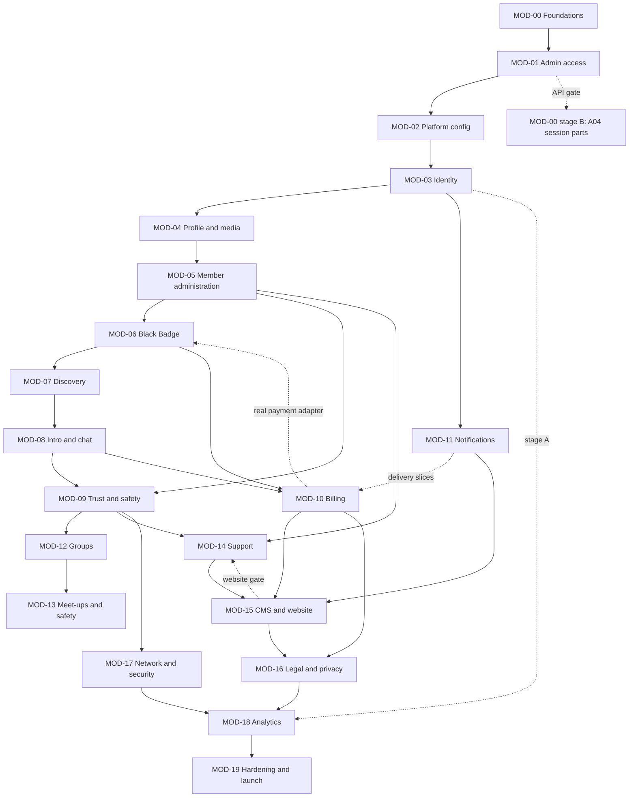

# 1MM-EXE-00 · Master execution plan

|              |                                                                                                                                                                                                                                                                                                                                                                   |
| ------------ | ----------------------------------------------------------------------------------------------------------------------------------------------------------------------------------------------------------------------------------------------------------------------------------------------------------------------------------------------------------------- |
| **Document** | 1MM-EXE-00                                                                                                                                                                                                                                                                                                                                                        |
| **Status**   | Approved baseline · v1.0 · 24 Nov 2026                                                                                                                                                                                                                                                                                                                            |
| **Audience** | Engineers and coding agents                                                                                                                                                                                                                                                                                                                                       |
| **Owner**    | Engineering lead (code owners)                                                                                                                                                                                                                                                                                                                                    |
| **Sources**  | [PACK], [OD-01] to [OD-40], [TR §8.2], [TR §11], [TR §17.2], [TR §17.3], [DD §1] to [DD §14], [SQL], [UF §15], [INV], [ADM §3], [ADM §4], [WEB §7], [WEB §8], and the twenty module plans `1MM-EXE-MOD-00` to `1MM-EXE-MOD-19`                                                                                                                                    |
| **Related**  | [1MM-INDEX](../1MM-INDEX.md) · [1MM-LOG-01](../1MM-LOG-01-PROGRESS.md) · [1MM-LOG-02](../1MM-LOG-02-UI-UPDATES.md) · [1MM-LOG-03](../1MM-LOG-03-TECHNICAL-REFERENCE-EXTENSIONS.md) · [1MM-STD-06](../standards/1MM-STD-06-API-FIRST.md) · [1MM-STD-07](../standards/1MM-STD-07-PROGRESS-UPDATES.md) · [1MM-STD-02](../standards/1MM-STD-02-AGENTIC-OPERATIONS.md) |

**What this document is for and when to open it.** It is the single ordered schedule for building
1minitman from the scaffold to public launch: which task runs when, which gate closes each stage,
and the proof that every screen, module, endpoint group, table and job has an owner. Open it at
the start of every session, and whenever a task needs something another module owns.

## 1. How to use this plan

### 1.1 Reading order

1. Find the current stage in [the progress log](../1MM-LOG-01-PROGRESS.md), then the same stage
   in section 4.2.
2. Open the module plan of the next task (section 2 links them). Read its sections 3 and 4 before
   writing code: every module starts with the data.
3. Check section 9.2 and section 10 for a gap or an owner decision that blocks the task. A
   blocked task is not started on a guess.
4. Do the task as one pull request. Log it. Move to the next task in the stage.
5. At the end of a stage, tick the gate named in section 4.2 and record it in the progress log.

### 1.2 Rules of execution

These are the owner's rules. They bind every stage.

| #   | Rule                                                                                                                                         | How this plan applies it                                                                                                                                                                                           |
| --- | -------------------------------------------------------------------------------------------------------------------------------------------- | ------------------------------------------------------------------------------------------------------------------------------------------------------------------------------------------------------------------ |
| 1   | **API first.** No API, no resource provisioning, no client code. No half-built screen waits on a backend.                                    | Every module window is split in two stages: the API stage ends at the module's API gate (section 8.1); the client stage starts only after it. [1MM-STD-06](../standards/1MM-STD-06-API-FIRST.md) holds the method. |
| 2   | Order inside every module: **API → worker → admin → web (site, billing web app) → mobile.**                                                  | The task columns in section 4.2 are written in that order. Lanes inside a stage follow section 4.4.                                                                                                                |
| 3   | The plan is modular. A module covers every app it touches; it need not touch all of them.                                                    | Section 2 lists the apps per module.                                                                                                                                                                               |
| 4   | Every module starts with the data: the UI is set against the schema and every related resource.                                              | Section 3 of each module plan. No task starts before its module's data review is read.                                                                                                                             |
| 5   | Every UI element, text and rule a person meets is served by the API and managed in the admin console, including the console's own constants. | Each exit gate carries a "no hard-coded limit or copy" item (section 8.2).                                                                                                                                         |
| 6   | Executing the plan end to end delivers the full product, tested end to end.                                                                  | Section 4.3 states the orphan check; section 6 the coverage; section 12 the definition of complete.                                                                                                                |
| 7   | Every addition extends from the Technical Reference. What is missing is a gap, never a silent invention.                                     | Section 9. Gaps live in the document that found them and are consolidated in [1MM-LOG-03](../1MM-LOG-03-TECHNICAL-REFERENCE-EXTENSIONS.md).                                                                        |

Working rules that follow from them:

- **One task, one pull request**, named with the task id (`MOD-07-API-03`). A task that grows is
  split in the module plan first, not in the pull request.
- **Gates are binary.** An API gate or exit gate with one open item is open.
- **Progress is logged** in [1MM-LOG-01](../1MM-LOG-01-PROGRESS.md) at the end of every session
  and at every gate, to the format in [1MM-STD-07](../standards/1MM-STD-07-PROGRESS-UPDATES.md).
- **No real personal data** in any environment before the legal minimum is met [OD-10].
- Branches, reviews and merges follow the repository rules: pull request into `develop`, one
  code-owner review, signed commits, `verify` and CodeQL green, squash merge; `production` moves
  only by an approved merge from `develop`.

### 1.3 Standards to follow

| Area                    | Documents                                                                                                                                                                                                                                                                                                                                                                                                                                                                                                                                            |
| ----------------------- | ---------------------------------------------------------------------------------------------------------------------------------------------------------------------------------------------------------------------------------------------------------------------------------------------------------------------------------------------------------------------------------------------------------------------------------------------------------------------------------------------------------------------------------------------------- |
| Method and records      | [1MM-STD-06 API first](../standards/1MM-STD-06-API-FIRST.md), [1MM-STD-02 Agentic operations](../standards/1MM-STD-02-AGENTIC-OPERATIONS.md), [1MM-STD-07 Progress updates](../standards/1MM-STD-07-PROGRESS-UPDATES.md), [1MM-STD-08 Contributing](../standards/1MM-STD-08-CONTRIBUTING.md), [1MM-STD-05 README standard](../standards/1MM-STD-05-README-STANDARD.md)                                                                                                                                                                               |
| Code                    | [1MM-STD-14 Coding conventions](../standards/1MM-STD-14-CODING-CONVENTIONS.md), [1MM-STD-09 Formatting](../standards/1MM-STD-09-FORMATTING.md), [1MM-STD-10 Commits and local CI](../standards/1MM-STD-10-COMMITS-AND-LOCAL-CI.md), [1MM-STD-16 Defensive programming](../standards/1MM-STD-16-DEFENSIVE-PROGRAMMING.md), [1MM-STD-13 Error codes](../standards/1MM-STD-13-ERROR-CODES.md)                                                                                                                                                           |
| Data                    | [1MM-STD-15 Data structures and models](../standards/1MM-STD-15-DATA-STRUCTURES-AND-MODELS.md), [1MM-STD-12 Data handling](../standards/1MM-STD-12-DATA-HANDLING.md), [1MM-DB-01 Schemas](../database/1MM-DB-01-SCHEMAS.md), [1MM-DB-02 Migrations](../database/1MM-DB-02-MIGRATIONS.md), [1MM-DB-03 SQL structure](../database/1MM-DB-03-SQL-STRUCTURE.md), [1MM-DB-04 Indexing](../database/1MM-DB-04-INDEXING.md), [1MM-DB-05 Security](../database/1MM-DB-05-SECURITY.md), [1MM-DB-06 Data protection](../database/1MM-DB-06-DATA-PROTECTION.md) |
| Quality and safety      | [1MM-STD-01 Testing strategy](../standards/1MM-STD-01-TESTING-STRATEGY.md), [1MM-STD-11 Security and compliance](../standards/1MM-STD-11-SECURITY-AND-COMPLIANCE.md)                                                                                                                                                                                                                                                                                                                                                                                 |
| Clients                 | [1MM-STD-03 Mobile build strategy](../standards/1MM-STD-03-MOBILE-BUILD-STRATEGY.md), [1MM-STD-04 Brand guide](../standards/1MM-STD-04-BRAND-GUIDE.md), [1MM-STD-20 Design system](../standards/1MM-STD-20-DESIGN-SYSTEM.md), [1MM-STD-17 Language configuration](../standards/1MM-STD-17-LANGUAGE-CONFIGURATION.md), [1MM-STD-18 Notifications](../standards/1MM-STD-18-NOTIFICATIONS.md), [1MM-STD-19 OTA updates](../standards/1MM-STD-19-OTA-UPDATES.md)                                                                                         |
| Platforms and decisions | [1MM-RES-01 Open source and platforms](../resources/1MM-RES-01-OPEN-SOURCE-AND-PLATFORMS.md), [1MM-ADR-0000 Index](../adrs/1MM-ADR-0000-INDEX.md)                                                                                                                                                                                                                                                                                                                                                                                                    |

## 2. Module catalogue

Task counts are the task ids defined in section 8 of each module plan, counted by script
(section 4.3). "Open gaps" is the number of rows in the plan's "Gaps raised" table on
24 Nov 2026. Apps are the folders under `apps/`.

| Id        | Title                                                                                                   | Apps touched                               | Delivers                                                                                                                                                                                                                                             | Depends on (MOD)                                             | Unlocks (MOD)                                                 | API     | WRK    | DB     | ADM    | WEB    | MOB    | QA     | OPS    | Tasks   | Open gaps |
| --------- | ------------------------------------------------------------------------------------------------------- | ------------------------------------------ | ---------------------------------------------------------------------------------------------------------------------------------------------------------------------------------------------------------------------------------------------------- | ------------------------------------------------------------ | ------------------------------------------------------------- | ------- | ------ | ------ | ------ | ------ | ------ | ------ | ------ | ------- | --------- |
| MOD-00    | [Foundations and platform runtime](1MM-EXE-MOD-00-FOUNDATIONS.md)                                       | api, worker, admin, site, web, mobile      | Environments, CI/CD, API primitives (auth skeletons, problem+json, idempotency, pagination, rate limits, RLS context, WebSocket and SSE, storage, webhook intake, outbox), worker runtime, console design system and shell, website M1, mobile shell | none (stage B: MOD-01 API gate)                              | every module                                                  | 9       | 2      | 2      | 3      | 3      | 4      | 2      | 6      | 31      | 13        |
| MOD-01    | [Admin access and governance](1MM-EXE-MOD-01-ADMIN-ACCESS-AND-GOVERNANCE.md)                            | api, worker, admin                         | Admin sign-in with mandatory MFA, sessions and step-up, RBAC, four-eyes approvals, the hash-chained audit log, admin user management                                                                                                                 | 00                                                           | 02 onwards; MOD-00 stage B                                    | 10      | 2      | 1      | 6      | 0      | 0      | 2      | 0      | 21      | 13        |
| MOD-02    | [Platform configuration, catalogues and localisation](1MM-EXE-MOD-02-PLATFORM-CONFIG-AND-CATALOGUES.md) | api, worker, admin, site, web, mobile      | Config bootstrap, flags, remote config, app versions, maintenance, rate limits, markets, vendors, catalogues and the i18n API; OB1, OB2; W04 to W06                                                                                                  | 00, 01                                                       | every later module                                            | 8       | 1      | 2      | 4      | 3      | 3      | 1      | 0      | 22      | 13        |
| MOD-03    | [Member identity and authentication](1MM-EXE-MOD-03-MEMBER-IDENTITY-AND-AUTH.md)                        | api, worker, web, mobile                   | Sign-up in 10 steps, sign-in, recovery, providers, phone sign-in, sessions and settings; base `GET /v1/me`; web app sign-in                                                                                                                          | 00, 02                                                       | 04 onwards                                                    | 9       | 1      | 1      | 0      | 1      | 8      | 1      | 0      | 21      | 13        |
| MOD-04    | [Profile, media and prompts](1MM-EXE-MOD-04-PROFILE-MEDIA-AND-PROMPTS.md)                               | api, worker, admin, mobile                 | Profile, answers, preferences, prompts, media upload and the `media.process` pipeline; A13 moderation                                                                                                                                                | 00 to 03                                                     | 05, 06, 07, 08, 10, 12                                        | 5       | 2      | 1      | 1      | 0      | 4      | 1      | 0      | 14      | 8         |
| MOD-05    | [Member administration](1MM-EXE-MOD-05-MEMBER-ADMINISTRATION.md)                                        | api, worker, admin, mobile                 | Member directory, Member 360, member actions and sanctions; AS1 and H6                                                                                                                                                                               | 00 to 04                                                     | 06, 09, 10, 14, 16                                            | 8       | 1      | 1      | 3      | 0      | 1      | 2      | 0      | 16      | 5         |
| MOD-06    | [Black Badge verification](1MM-EXE-MOD-06-BLACK-BADGE-VERIFICATION.md)                                  | api, worker, admin, mobile                 | Black Badge application, phone step, liveness, the A12 review queue, decisions, refund and purge jobs                                                                                                                                                | 00 to 05; ports from 10, 11                                  | 07, 08; phone sign-in in 03; trial in 10                      | 9       | 2      | 1      | 3      | 0      | 6      | 1      | 0      | 22      | 11        |
| MOD-07    | [Discovery, reactions, matching and Spotlight](1MM-EXE-MOD-07-DISCOVERY-AND-MATCHING.md)                | api, worker, admin, mobile                 | Deck, quota, reactions, Undo, likes, match creation, status and Spotlight; A24 tuning                                                                                                                                                                | 00 to 04, 06                                                 | 08, 11, 18                                                    | 8       | 2      | 1      | 2      | 0      | 9      | 1      | 0      | 23      | 10        |
| MOD-08    | [1-Minute Intro, chat, Direct Specs and calls](1MM-EXE-MOD-08-INTRO-CHAT-AND-DIRECT-SPECS.md)           | api, worker, mobile                        | Matches, 1-Minute Intro, chat, Direct Specs and realtime events; calls contract behind a flag                                                                                                                                                        | 00, 02, 03, 04, 06, 07                                       | 09, 10, 12, 13                                                | 13      | 4      | 1      | 0      | 0      | 8      | 2      | 0      | 28      | 13        |
| MOD-09    | [Trust and safety](1MM-EXE-MOD-09-TRUST-AND-SAFETY.md)                                                  | api, worker, admin, mobile                 | Reports, blocks, moderation cases, evidence, appeals, sanctions ladder and abuse rules; H3 to H5                                                                                                                                                     | 00, 01, 02, 03, 05, 07, 08                                   | 12, 13, 16, 19                                                | 9       | 2      | 1      | 4      | 0      | 4      | 1      | 0      | 21      | 13        |
| MOD-10    | [Billing, plans and entitlements](1MM-EXE-MOD-10-BILLING-PLANS-AND-ENTITLEMENTS.md)                     | api, worker, admin, web, mobile            | Plans, purchases on the stores and the web, billing lifecycle, entitlements, refunds and disputes, revenue reports; web app checkout                                                                                                                 | 00 to 08; 11 delivery slices                                 | money path of 06; paid surfaces of 07, 08, 12; 05, 09, 15, 18 | 10      | 2      | 1      | 4      | 2      | 4      | 1      | 0      | 24      | 12        |
| MOD-11    | [Notifications and communications](1MM-EXE-MOD-11-NOTIFICATIONS-AND-COMMUNICATIONS.md)                  | api, worker, admin, site, mobile           | Notification delivery (push, e-mail, SMS, in-app), preferences, templates, broadcasts and the newsletter                                                                                                                                             | 00, 01, 02, 03; W36: form pipeline of 14, website gate of 15 | every module that writes a notification row; 15               | 7       | 2      | 1      | 2      | 1      | 3      | 1      | 1      | 18      | 9         |
| MOD-12    | [Groups](1MM-EXE-MOD-12-GROUPS.md)                                                                      | api, worker, admin, mobile                 | Groups: browse, create, join, invite and room messaging; A18 groups review                                                                                                                                                                           | 00 to 06, 08, 09                                             | 13, 08                                                        | 9       | 2      | 1      | 2      | 0      | 4      | 2      | 0      | 20      | 12        |
| MOD-13    | [Meet-ups and personal safety](1MM-EXE-MOD-13-MEETUPS-AND-PERSONAL-SAFETY.md)                           | api, worker, admin, site, mobile           | Meet-ups, venues, check-ins, trusted contacts, share links and the A15 safety desk                                                                                                                                                                   | 00, 01, 02, 03, 05, 08, 09, 12                               | 09, 14, 11, 16, 19                                            | 10      | 4      | 1      | 4      | 1      | 5      | 2      | 1      | 28      | 12        |
| MOD-14    | [Support and help](1MM-EXE-MOD-14-SUPPORT-AND-HELP.md)                                                  | api, worker, admin, site, mobile           | Help centre, support chat and feedback; A27; W32 to W34; the shared public form pipeline                                                                                                                                                             | 00, 01, 02, 03, 05, 09; website tasks: 15                    | 15, 16, 19                                                    | 7       | 1      | 1      | 5      | 3      | 3      | 1      | 1      | 22      | 17        |
| MOD-15    | [CMS and public website](1MM-EXE-MOD-15-CMS-AND-PUBLIC-WEBSITE.md)                                      | api, worker, admin, site                   | CMS (A28, A29), publish pipeline, public content API, website pages, waitlist, careers and stories                                                                                                                                                   | 00, 01, 02, 03, 10, 11, 14                                   | website tasks of 14; 16, 18, 19                               | 10      | 2      | 1      | 4      | 6      | 0      | 1      | 1      | 25      | 16        |
| MOD-16    | [Legal, privacy and data operations](1MM-EXE-MOD-16-LEGAL-PRIVACY-AND-DATA-OPERATIONS.md)               | api, worker, admin, site, mobile           | Legal documents and re-acceptance, consents, export, deletion and erasure, retention and legal holds; A30, A36; W03, W35                                                                                                                             | 00, 01, 02, 03, 05, 10, 11, 14, 15                           | 19                                                            | 6       | 3      | 1      | 2      | 2      | 3      | 1      | 0      | 18      | 11        |
| MOD-17    | [Network and security operations](1MM-EXE-MOD-17-NETWORK-AND-SECURITY-OPERATIONS.md)                    | api, worker, admin                         | Traffic rollups, IP rules, detections, incidents and WAF status; A32                                                                                                                                                                                 | 00, 01, 02, 03, 09                                           | 19; the OD-29 rule in 01                                      | 6       | 3      | 1      | 3      | 0      | 0      | 1      | 1      | 15      | 9         |
| MOD-18    | [Analytics, overview and research](1MM-EXE-MOD-18-ANALYTICS-OVERVIEW-AND-RESEARCH.md)                   | api, worker, admin, site, web, mobile      | Event pipeline and catalogue, rollups, overview, analytics and research; A33 to A35                                                                                                                                                                  | 00 to 03; tables of 04 to 17; website part: 15, 16           | 19                                                            | 6       | 2      | 2      | 3      | 1      | 1      | 1      | 1      | 17      | 13        |
| MOD-19    | [Hardening, end-to-end verification and launch](1MM-EXE-MOD-19-HARDENING-AND-LAUNCH.md)                 | all six, for verification and release only | Contract freeze, end-to-end journeys, load, accessibility and penetration tests, production, legal steps, stores, beta and launch                                                                                                                    | 00 to 18                                                     | private beta, then public launch                              | 0       | 0      | 0      | 0      | 0      | 0      | 6      | 8      | 14      | 6         |
| **Total** |                                                                                                         |                                            |                                                                                                                                                                                                                                                      |                                                              |                                                               | **159** | **40** | **22** | **55** | **23** | **70** | **31** | **20** | **420** | **229**   |

Notes on the counts:

- MOD-02, MOD-03, MOD-06 and MOD-07 write their API gate as a table row without a task id; it is
  a gate, not a task, and is not counted.
- MOD-19 skips `MOD-19-OPS-03` on purpose (its plan says the id is unused).
- Five task ids are deferred until after launch: `MOD-06-API-09` (GD1 carrier check, [OD-06]) and
  `MOD-08-API-D1`, `MOD-08-API-D2`, `MOD-08-MOB-D1`, `MOD-08-QA-D1` (calls, [OD-20]). They are
  counted and scheduled in stage 44.

## 3. Dependency graph

### 3.1 Module dependencies

An arrow reads "is needed by". Edges come from the **Depends on** row of each module plan; edges
implied by another edge are left out. MOD-00 and MOD-02 are needed by every later module and
MOD-19 needs every module.

Dotted edges are the places where a slice of one module runs inside another module's window.
Section 4 schedules each of them.

### 3.2 Cross-module ports, stubs and first versions

Ruling R7 governs all of these: an earlier module depends on a port with a stub or builds a
first version; the owner supplies or completes the real thing; no client screen is built against
a stub.

| Port or shared piece                                                             | Defined or first built in                                                                                                          | Stub until the owner arrives                             | Real adapter or completion                                                                                                                                      | Ruling   |
| -------------------------------------------------------------------------------- | ---------------------------------------------------------------------------------------------------------------------------------- | -------------------------------------------------------- | --------------------------------------------------------------------------------------------------------------------------------------------------------------- | -------- |
| Media upload URL and `media.process` pipeline                                    | `MOD-04-API-04`, `MOD-04-WRK-01`                                                                                                   | none: built once                                         | MOD-06, MOD-08, MOD-12 add their kinds and rules                                                                                                                | R1       |
| Transcoder, face matcher and moderator ports of `media.process`                  | `MOD-04-WRK-01`                                                                                                                    | fixture adapters; providers are undecided (GAP-MOD04-04) | Bound when the owner names providers; live face match proven in MOD-06                                                                                          | R7       |
| Read-only entitlement resolver and `GET /v1/me/entitlements`                     | `MOD-03-API-08` (assigned by the resolution of GAP-EXE00-01)                                                                       | seeded entitlement matrix                                | `MOD-10-API-02` owns everything that changes entitlements                                                                                                       | R2, R10  |
| `GET /v1/me`                                                                     | base in `MOD-03-API-08`                                                                                                            | none                                                     | extended by `MOD-04-API-01`                                                                                                                                     | R3, R12  |
| `GET /v1/discovery/count`                                                        | first version in `MOD-04-API-02`                                                                                                   | none                                                     | `MOD-07-API-02` extends and owns it                                                                                                                             | R4       |
| `GET /v1/me/account-status`, `POST /v1/appeals`                                  | `MOD-05-API-07`                                                                                                                    | none                                                     | `MOD-09-API-05` extends them additively                                                                                                                         | R5       |
| Member 360 tabs                                                                  | `MOD-05-API-03`, `MOD-05-ADM-02`                                                                                                   | tabs are empty until their module ships                  | each later module verifies its tab; tracked by `MOD-05-QA-02`                                                                                                   | R6       |
| Abuse-rule evaluator                                                             | `MOD-03-API-03`, behind a port (assigned by the resolution of GAP-EXE00-03)                                                        | the three seeded rules                                   | `MOD-09-API-02` adopts and completes it; `MOD-08-API-06` and MOD-12 call it                                                                                     | R9       |
| `NotificationOutbox`, `EmailSender`, `SmsSender`, provider webhook routes        | `MOD-11-API-01` (slice A) on the MOD-00 outbox helper and intake (`MOD-00-API-08`)                                                 | none: real senders from the start, console sink in tests | `notifications.deliver` v1 in `MOD-11-WRK-01` (slice B); `PushSender` and preferences in `MOD-11-API-02`, `-03`, `MOD-11-WRK-02` (slice C)                      | R10, R21 |
| Legal documents for C5                                                           | read `GET /v1/legal/{kind}` in MOD-03; non-production drafts seeded in `MOD-03-DB-01` (assigned by the resolution of GAP-EXE00-02) | draft v0.9, non-production only                          | authored and replaced through A30 in `MOD-16-API-01`, `MOD-16-ADM-01`                                                                                           | R12      |
| Site banner and website maintenance                                              | read path and W06 in `MOD-02-API-03`, `MOD-02-WEB-02`                                                                              | seeded settings                                          | edited in A28: `MOD-15-ADM-02` proves a real scheduled banner                                                                                                   | R13      |
| `BadgePayment` (price, purchase, proof, system refund, grant, trial eligibility) | `MOD-06-API-05`                                                                                                                    | contract-tested fake                                     | `MOD-10-API-09`; money run closes in `MOD-10-QA-01`                                                                                                             | R14      |
| `LivenessVendor`                                                                 | `MOD-06-API-04`                                                                                                                    | fake for tests                                           | AWS adapter in the same task                                                                                                                                    | R7       |
| Pending-action replay hook                                                       | `MOD-06-API-08`                                                                                                                    | none                                                     | consumed by `MOD-07-API-04` for Like and Somewhat                                                                                                               | R7       |
| `GET /v1/matches/{id}` minimal read; `match.created`, `maybe.created`            | `MOD-07-API-06`, `MOD-07-API-04`                                                                                                   | none                                                     | extended by `MOD-08-API-02`                                                                                                                                     | R15      |
| Review-queue mechanics (claim, release, stale-claim release)                     | MOD-04 with A13 (`MOD-04-API-05`)                                                                                                  | none                                                     | reused by A12 (`MOD-06-API-07`) and A14 (`MOD-09-API-06`); `MOD-06-WRK-02` and `MOD-09-WRK-01` register their queues with the one stale-claim release job (R29) | R16, R29 |
| Billing effects of sanctions                                                     | `MOD-05-API-05`                                                                                                                    | no-op adapter that records the intent                    | `MOD-10-API-09` replays the recorded intents                                                                                                                    | R7       |
| Credit days after a lifted or overturned sanction                                | MOD-05, `MOD-09-API-08`                                                                                                            | port                                                     | `MOD-10-API-09` (`billing_credits`)                                                                                                                             | R7       |
| Web plan cancellation at erasure                                                 | `MOD-10-API-09`                                                                                                                    | none: MOD-10 runs first                                  | called by `MOD-16-API-04`                                                                                                                                       | R7       |
| `closeConversation` service                                                      | `MOD-08-API-09`                                                                                                                    | none                                                     | called by `MOD-09-API-03`                                                                                                                                       | R8       |
| `POST /v1/blocks`, `POST /v1/reports`                                            | MOD-09 slice (`MOD-09-API-03`, `-04`)                                                                                              | none: scheduled early                                    | wired by the mobile work of MOD-08, MOD-12, MOD-13                                                                                                              | R8       |
| `postGroupSystemMessage`; D13 and GC5 slots                                      | `MOD-12-API-07`, `MOD-12-MOB-02`, `-03`                                                                                            | named slots                                              | filled by `MOD-13-API-03`, `MOD-13-MOB-05`                                                                                                                      | R7       |
| `raiseEscalation`                                                                | `MOD-13-API-04`                                                                                                                    | none                                                     | called by MOD-09 and MOD-14                                                                                                                                     | R7       |
| `QueueReassigner`                                                                | `MOD-01-API-08`                                                                                                                    | ships with no reassigners                                | reassigners registered by MOD-09 (cases), `MOD-13-API-09` (escalations), `MOD-14-API-03` (tickets), MOD-15                                                      | R7       |
| `ApprovalEngine` executor registry, `PermissionGuard`, `AuditWriter`             | `MOD-01-API-06`, `-03`, `-02`                                                                                                      | test executor                                            | every module with an approval adds its executor                                                                                                                 | R7       |
| "Incident open" port for the OD-29 unlock rule                                   | `MOD-17-API-05`                                                                                                                    | none in MOD-01 until then                                | verified with MOD-01 in MOD-17's exit gate                                                                                                                      | R7       |
| Shared public form pipeline; first `POST /public/v1/uploads`                     | `MOD-14-API-05`, `MOD-14-API-06`                                                                                                   | none                                                     | reused by MOD-15, MOD-11 (W36), MOD-16 (W03); built in stage 24 (R25)                                                                                           | R24, R25 |
| Website renderer and content build                                               | `MOD-15-WEB-01` on the M1 shell of `MOD-00-WEB-01`                                                                                 | stub settings in M1                                      | W32 to W34, W36, W03 and W35 plug in after it                                                                                                                   | R24      |
| Erasure and export manifests; purge counts per rule                              | owned by MOD-16 (`MOD-16-WRK-02`, `-03`); run records in MOD-00                                                                    | none                                                     | every module registers its tables and returns counts                                                                                                            | R23      |
| Analytics event catalogue                                                        | `MOD-18-API-01`                                                                                                                    | modules mark event names as proposed                     | coverage run `MOD-18-QA-01`                                                                                                                                     | R17      |
| `worker_jobs.cron` values                                                        | each module seeds its own jobs                                                                                                     | none                                                     | shown on the A31 Jobs page (`MOD-02-ADM-02`)                                                                                                                    | R20      |

## 4. The execution sequence

### 4.1 How the sequence is built

Modules run in number order. Inside a module the order is API → worker → admin → web → mobile,
closed by the exit gate. The rulings and the plans then move slices:

| Move                                            | Tasks                                                                    | From → to                                                       | Basis                                                                  |
| ----------------------------------------------- | ------------------------------------------------------------------------ | --------------------------------------------------------------- | ---------------------------------------------------------------------- |
| Notification senders and outbox port            | `MOD-11-OPS-01`, `MOD-11-API-01`                                         | MOD-11 → stage 1                                                | R21 slice A                                                            |
| Transactional delivery                          | `MOD-11-WRK-01`                                                          | MOD-11 → stage 7, before MOD-03's API gate                      | R21 slice B                                                            |
| Push, preferences, quiet hours                  | `MOD-11-API-02`, `-03`, `MOD-11-WRK-02`                                  | MOD-11 → stage 8, before `MOD-03-MOB-05`                        | R21 slice C                                                            |
| Event pipeline                                  | `MOD-18-DB-01`, `MOD-18-API-01`, `-02`, `MOD-18-MOB-01`, `MOD-18-OPS-01` | MOD-18 → stage 8                                                | MOD-18 section 8, stage A; R28 for the OPS task                        |
| Session-bound console shell                     | `MOD-00-ADM-03`, `MOD-00-QA-02`                                          | MOD-00 → stage 4, after MOD-01's API gate                       | R20                                                                    |
| Forced re-verification                          | `MOD-05-API-08`                                                          | MOD-05 → stage 14, after MOD-06's API gate                      | MOD-05 section 8                                                       |
| B9, B10, B11 and the Black Badge end-to-end run | `MOD-06-MOB-05`, `MOD-06-QA-01`                                          | MOD-06 → stage 23, after MOD-10's API gate                      | R14                                                                    |
| Blocks and reports API                          | `MOD-09-DB-01`, `MOD-09-API-01` to `-04`                                 | MOD-09 → stage 18, before the mobile work of MOD-08             | R8                                                                     |
| Public form pipeline                            | `MOD-14-API-05`                                                          | MOD-14 → stage 24                                               | R24, R25                                                               |
| W32 to W34                                      | `MOD-14-WEB-01` to `-03`, `MOD-14-QA-01`                                 | MOD-14 → stage 34, after MOD-15's API gate and `MOD-15-WEB-01`  | R24                                                                    |
| W36                                             | `MOD-11-WEB-01`                                                          | MOD-11 → stage 34                                               | R26                                                                    |
| Website analytics                               | `MOD-18-WEB-01`                                                          | MOD-18 → stage 36, after the site shell and W03                 | MOD-18 section 8                                                       |
| Standing verifications                          | `MOD-05-QA-02`, `MOD-11-QA-01`                                           | closed in stage 36, when the last module they check has shipped | R6, R10                                                                |
| Deploy hook before the CMS publish test         | `MOD-15-OPS-01`                                                          | inside MOD-15, from the admin block to the API stage            | `MOD-15-WRK-01` needs it; MOD-15's API gate needs a publish on staging |

First versions that an earlier module builds for a later owner (R2 to R5, R9, R12, R15, R16) do
not move tasks: they are part of the earlier module's own tasks and are listed in section 3.2.

### 4.2 Schedule

A stage is closed by its gate. The next stage does not start before that, except where section
4.4 allows a lane to run ahead. In the tasks column, `MOD-00-API-01` to `-09` means the nine
tasks `MOD-00-API-01` … `MOD-00-API-09`.

| Stage | Window                                               | Tasks, in order                                                                                                                                                                  | Count | Gate that closes the stage                                                                                            | What may run in parallel                                                                                                                           |
| ----- | ---------------------------------------------------- | -------------------------------------------------------------------------------------------------------------------------------------------------------------------------------- | ----- | --------------------------------------------------------------------------------------------------------------------- | -------------------------------------------------------------------------------------------------------------------------------------------------- |
| 1     | MOD-00 platform, with MOD-11 slice A                 | `MOD-00-OPS-01` to `-04`, `MOD-00-DB-01` to `-02`, `MOD-00-API-01` to `-09`, `MOD-00-WRK-01` to `-02`, `MOD-11-OPS-01`, `MOD-11-API-01`, `MOD-00-QA-01`                          | 20    | MOD-00 API gate (`MOD-00-QA-01`)                                                                                      | Lane 1 infrastructure (OPS); lane 2 database and API primitives; lane 3 gateway, intake and worker; lane 4 slice A once `MOD-00-API-08` is merged  |
| 2     | MOD-00 clients, stage A                              | `MOD-00-ADM-01` to `-02`, `MOD-00-WEB-01` to `-03`, `MOD-00-MOB-01` to `-04`, `MOD-00-OPS-05` to `-06`                                                                           | 11    | MOD-00 exit gate, stage A items; `MOD-00-ADM-03` stays open                                                           | Lane 1 console; lane 2 website and billing web app; lane 3 mobile; lane 4 budgets and alerts                                                       |
| 3     | MOD-01 API                                           | `MOD-01-DB-01`, `MOD-01-API-01` to `-10`, `MOD-01-WRK-01` to `-02`, `MOD-01-QA-01`                                                                                               | 14    | MOD-01 API gate (`MOD-01-QA-01`)                                                                                      | Two lanes after `MOD-01-API-03`: sign-in and sessions (`-04`, `-05`); approvals, RBAC, admins, alerts (`-06` to `-09`). Audit read and jobs follow |
| 4     | MOD-01 console, with MOD-00 stage B                  | `MOD-01-ADM-01` to `-06`, `MOD-00-ADM-03`, `MOD-01-QA-02`, `MOD-00-QA-02`                                                                                                        | 9     | MOD-01 exit gate and MOD-00 exit gate (both signed)                                                                   | Lane 1 A02 then A03; lanes 2 and 3 take A05, A06, A07 after `MOD-01-ADM-02`; `MOD-00-ADM-03` runs beside them (ruling R20)                         |
| 5     | MOD-02 API                                           | `MOD-02-DB-01` to `-02`, `MOD-02-API-01` to `-08`, `MOD-02-WRK-01`                                                                                                               | 11    | MOD-02 API gate (row 12 of its work breakdown)                                                                        | Lane 1 config, flags, versions, maintenance; lane 2 catalogues and options; lane 3 i18n                                                            |
| 6     | MOD-02 clients                                       | `MOD-02-ADM-01` to `-04`, `MOD-02-WEB-01` to `-03`, `MOD-02-MOB-01` to `-03`, `MOD-02-QA-01`                                                                                     | 11    | MOD-02 exit gate                                                                                                      | Lane 1 console; lane 2 website and web app; lane 3 mobile                                                                                          |
| 7     | MOD-03 API, with MOD-11 slice B                      | `MOD-03-DB-01`, `MOD-03-API-01` to `-09`, `MOD-03-WRK-01`, `MOD-11-WRK-01`                                                                                                       | 12    | MOD-03 API gate (row 12 of its work breakdown)                                                                        | After `MOD-03-API-02`: lane 1 sign-up; lane 2 sign-in and recovery; lane 3 providers, phone, sessions, cookie mode; lane 4 slice B                 |
| 8     | MOD-11 slice C, MOD-18 stage A, MOD-03 clients       | `MOD-11-API-02` to `-03`, `MOD-11-WRK-02`, `MOD-18-DB-01`, `MOD-18-API-01` to `-02`, `MOD-18-OPS-01`, `MOD-03-WEB-01`, `MOD-03-MOB-01` to `-08`, `MOD-18-MOB-01`, `MOD-03-QA-01` | 18    | MOD-03 exit gate; MOD-18 stage A check (consent tests green)                                                          | Lane 1 slice C (must merge before `MOD-03-MOB-05`); lane 2 analytics pipeline; lane 3 web sign-in; lanes 4 and 5 mobile                            |
| 9     | MOD-04 API                                           | `MOD-04-DB-01`, `MOD-04-API-01` to `-04`, `MOD-04-WRK-01` to `-02`, `MOD-04-API-05`                                                                                              | 8     | MOD-04 API gate                                                                                                       | Lane 1 profile and answers; lane 2 prompts; lane 3 upload and `media.process`; A13 endpoints last                                                  |
| 10    | MOD-04 clients                                       | `MOD-04-ADM-01`, `MOD-04-MOB-01` to `-04`, `MOD-04-QA-01`                                                                                                                        | 6     | MOD-04 exit gate                                                                                                      | Lane 1 A13; lanes 2 and 3 mobile                                                                                                                   |
| 11    | MOD-05 API                                           | `MOD-05-DB-01`, `MOD-05-API-01` to `-07`, `MOD-05-WRK-01`                                                                                                                        | 9     | MOD-05 API gate                                                                                                       | Lane 1 masking, directory, Member 360; lane 2 actions and sanctions; lane 3 account status and appeals                                             |
| 12    | MOD-05 clients                                       | `MOD-05-ADM-01` to `-03`, `MOD-05-MOB-01`, `MOD-05-QA-01`                                                                                                                        | 5     | MOD-05 exit gate (`MOD-05-API-08` and `MOD-05-QA-02` carried)                                                         | Lanes 1 to 3 console; lane 4 mobile                                                                                                                |
| 13    | MOD-06 API                                           | `MOD-06-DB-01`, `MOD-06-API-01` to `-08`, `MOD-06-WRK-01` to `-02`                                                                                                               | 11    | MOD-06 API gate                                                                                                       | Lane 1 lifecycle, submit, replay hook; lane 2 phone and liveness; lane 3 admin queue and jobs                                                      |
| 14    | MOD-06 clients without B9, with the MOD-05 follow-up | `MOD-05-API-08`, `MOD-06-ADM-01` to `-03`, `MOD-06-MOB-01` to `-04`, `MOD-06-MOB-06`                                                                                             | 9     | MOD-06 exit-gate items that need no real payment; `MOD-06-MOB-05` and `MOD-06-QA-01` carried to stage 23 (ruling R14) | Lane 1 `MOD-05-API-08`; lane 2 A12; lanes 3 and 4 mobile                                                                                           |
| 15    | MOD-07 API                                           | `MOD-07-DB-01`, `MOD-07-API-01` to `-08`, `MOD-07-WRK-01` to `-02`                                                                                                               | 11    | MOD-07 API gate                                                                                                       | Lane 1 deck and quota; lane 2 reactions, likes, match read; lane 3 Spotlight and status                                                            |
| 16    | MOD-07 clients                                       | `MOD-07-ADM-01` to `-02`, `MOD-07-MOB-01` to `-09`, `MOD-07-QA-01`                                                                                                               | 12    | MOD-07 exit gate                                                                                                      | Lane 1 A24; lanes 2 to 4 mobile after `MOD-07-MOB-01`                                                                                              |
| 17    | MOD-08 API                                           | `MOD-08-DB-01`, `MOD-08-API-01` to `-11`, `MOD-08-WRK-01` to `-04`                                                                                                               | 16    | MOD-08 API gate                                                                                                       | Lane 1 intro; lane 2 conversations and send pipeline; lane 3 Direct Specs, unmatch, sockets; lane 4 worker                                         |
| 18    | MOD-09 blocks and reports slice                      | `MOD-09-DB-01`, `MOD-09-API-01` to `-04`                                                                                                                                         | 5     | Slice gate (section 4.3, note 18)                                                                                     | Lane 1 evaluator; lane 2 blocks; lane 3 reports                                                                                                    |
| 19    | MOD-08 mobile                                        | `MOD-08-MOB-01` to `-07`, `MOD-08-QA-01`                                                                                                                                         | 8     | MOD-08 exit gate                                                                                                      | Lanes 1 to 3 after `MOD-08-MOB-01` and `-03`                                                                                                       |
| 20    | MOD-09 remaining API                                 | `MOD-09-API-05` to `-09`, `MOD-09-WRK-01` to `-02`                                                                                                                               | 7     | MOD-09 API gate                                                                                                       | Lane 1 cases and reports admin; lane 2 appeals and ladder; lane 3 abuse rules                                                                      |
| 21    | MOD-09 clients                                       | `MOD-09-ADM-01` to `-04`, `MOD-09-MOB-01` to `-04`, `MOD-09-QA-01`                                                                                                               | 9     | MOD-09 exit gate                                                                                                      | Lanes 1 and 2 console; lanes 3 and 4 mobile                                                                                                        |
| 22    | MOD-10 API                                           | `MOD-10-DB-01`, `MOD-10-API-01` to `-10`, `MOD-10-WRK-01` to `-02`                                                                                                               | 13    | MOD-10 API gate                                                                                                       | Lane 1 RevenueCat; lane 2 Flutterwave; lane 3 reads, trial, lapse; adapters and admin endpoints last                                               |
| 23    | MOD-10 clients, with the MOD-06 money path           | `MOD-10-ADM-01` to `-04`, `MOD-10-WEB-01` to `-02`, `MOD-10-MOB-01` to `-04`, `MOD-06-MOB-05`, `MOD-06-QA-01`, `MOD-10-QA-01`                                                    | 13    | MOD-10 exit gate and MOD-06 exit gate                                                                                 | Lane 1 console; lane 2 web app; lanes 3 and 4 mobile; `MOD-06-MOB-05` after `MOD-10-MOB-01`                                                        |
| 24    | MOD-11 remaining API, with the public form pipeline  | `MOD-14-API-05`, `MOD-11-DB-01`, `MOD-11-API-04` to `-07`                                                                                                                        | 6     | MOD-11 API gate                                                                                                       | Lane 1 form pipeline then newsletter; lane 2 templates and broadcasts; lane 3 logs and suppressions                                                |
| 25    | MOD-11 console and mobile                            | `MOD-11-ADM-01` to `-02`, `MOD-11-MOB-01` to `-03`                                                                                                                               | 5     | MOD-11 exit-gate items except W36 and the full template run (carried to stages 34 and 36)                             | Lane 1 console; lanes 2 and 3 mobile                                                                                                               |
| 26    | MOD-12 API                                           | `MOD-12-DB-01`, `MOD-12-API-01` to `-09`, `MOD-12-WRK-01` to `-02`                                                                                                               | 12    | MOD-12 API gate                                                                                                       | Lane 1 read and membership; lane 2 create and invites; lane 3 messages and fan-out; lane 4 admin routes                                            |
| 27    | MOD-12 clients                                       | `MOD-12-ADM-01` to `-02`, `MOD-12-MOB-01` to `-04`, `MOD-12-QA-01` to `-02`                                                                                                      | 8     | MOD-12 exit gate                                                                                                      | Lane 1 console; lanes 2 and 3 mobile                                                                                                               |
| 28    | MOD-13 API                                           | `MOD-13-DB-01`, `MOD-13-API-01` to `-10`, `MOD-13-WRK-01` to `-04`, `MOD-13-OPS-01`                                                                                              | 16    | MOD-13 API gate                                                                                                       | Lane 1 venues and meet-ups; lane 2 check-ins, contacts, shares; lane 3 admin; lane 4 worker and alerts                                             |
| 29    | MOD-13 clients                                       | `MOD-13-ADM-01` to `-04`, `MOD-13-WEB-01`, `MOD-13-MOB-01` to `-05`, `MOD-13-QA-01` to `-02`                                                                                     | 12    | MOD-13 exit gate                                                                                                      | Lanes 1 and 2 console; lane 3 `/s/<token>` page; lanes 4 and 5 mobile                                                                              |
| 30    | MOD-14 API                                           | `MOD-14-DB-01`, `MOD-14-API-01` to `-04`, `MOD-14-API-06` to `-07`, `MOD-14-WRK-01`                                                                                              | 8     | MOD-14 API gate                                                                                                       | Lane 1 member help and tickets; lane 2 admin tickets and help centre; lane 3 uploads, contact and safety form                                      |
| 31    | MOD-14 console and mobile                            | `MOD-14-ADM-01` to `-05`, `MOD-14-OPS-01`, `MOD-14-MOB-01` to `-03`                                                                                                              | 9     | MOD-14 exit-gate items except W32 to W34 (carried to stage 34)                                                        | Lanes 1 and 2 console; lane 3 mobile; lane 4 alerts                                                                                                |
| 32    | MOD-15 API                                           | `MOD-15-DB-01`, `MOD-15-API-01` to `-10`, `MOD-15-OPS-01`, `MOD-15-WRK-01` to `-02`                                                                                              | 14    | MOD-15 API gate                                                                                                       | Lane 1 pages, validator, public reads; lane 2 settings, media, collections; lane 3 forms and waitlist; lane 4 publish pipeline                     |
| 33    | MOD-15 console and content build                     | `MOD-15-ADM-01` to `-04`, `MOD-15-WEB-01`                                                                                                                                        | 5     | Website gate (MOD-14 section 8; ruling R24): [WEB §7] M2 review state                                                 | Lanes 1 to 3 console; lane 4 site renderer                                                                                                         |
| 34    | Website build-out: MOD-15, MOD-14 and MOD-11 pages   | `MOD-15-WEB-02` to `-06`, `MOD-14-WEB-01` to `-03`, `MOD-11-WEB-01`, `MOD-14-QA-01`, `MOD-15-QA-01`                                                                              | 11    | MOD-15 exit gate and MOD-14 exit gate                                                                                 | Lane 1 MOD-15 pages in order; lane 2 W32 to W34; lane 3 W36                                                                                        |
| 35    | MOD-16 API                                           | `MOD-16-DB-01`, `MOD-16-API-01` to `-06`, `MOD-16-WRK-01` to `-03`                                                                                                               | 10    | MOD-16 API gate                                                                                                       | Lane 1 legal authoring and consents; lane 2 export; lane 3 deletion and erasure; lane 4 register, holds, retention                                 |
| 36    | MOD-16 clients, with the carried closures            | `MOD-16-ADM-01` to `-02`, `MOD-16-WEB-01` to `-02`, `MOD-16-MOB-01` to `-03`, `MOD-16-QA-01`, `MOD-18-WEB-01`, `MOD-05-QA-02`, `MOD-11-QA-01`                                    | 11    | MOD-16 exit gate; MOD-11 exit gate; MOD-05 tab verification closed                                                    | Lane 1 console; lane 2 website; lane 3 mobile; lane 4 template re-verification; lane 5 website analytics                                           |
| 37    | MOD-17 API                                           | `MOD-17-OPS-01`, `MOD-17-DB-01`, `MOD-17-API-01` to `-06`, `MOD-17-WRK-01` to `-03`                                                                                              | 11    | MOD-17 API gate                                                                                                       | Lane 1 rollups and reads; lane 2 IP rules and incidents; lane 3 jobs                                                                               |
| 38    | MOD-17 console                                       | `MOD-17-ADM-01` to `-03`, `MOD-17-QA-01`                                                                                                                                         | 4     | MOD-17 exit gate                                                                                                      | Three console lanes                                                                                                                                |
| 39    | MOD-18 stage B API                                   | `MOD-18-DB-02`, `MOD-18-WRK-01`, `MOD-18-API-03` to `-06`, `MOD-18-WRK-02`                                                                                                       | 7     | MOD-18 API gate                                                                                                       | Lane 1 registry and overview; lane 2 analytics tabs; lane 3 reports and research                                                                   |
| 40    | MOD-18 console                                       | `MOD-18-ADM-01` to `-03`, `MOD-18-QA-01`                                                                                                                                         | 4     | MOD-18 exit gate                                                                                                      | Three console lanes; coverage run last                                                                                                             |
| 41    | MOD-19 release candidate and production              | `MOD-19-QA-01` to `-06`, `MOD-19-OPS-01` to `-02`, `MOD-19-OPS-05` to `-07`                                                                                                      | 11    | Readiness for S1: the "Needs" of `MOD-19-OPS-08`                                                                      | Lane 1 journeys; lane 2 load and budgets; lane 3 penetration test; lane 4 production and drills; lane 5 legal and stores                           |
| 42    | S1 private beta                                      | `MOD-19-OPS-08`                                                                                                                                                                  | 1     | Beta exit review                                                                                                      | One lane; fixes return as ordinary pull requests                                                                                                   |
| 43    | S2 public launch                                     | `MOD-19-OPS-04`, `MOD-19-OPS-09`                                                                                                                                                 | 2     | Launch gate: MOD-19 exit gate                                                                                         | One lane                                                                                                                                           |
| 44    | After launch (deferred, behind flags)                | `MOD-06-API-09`, `MOD-08-API-D1`, `MOD-08-API-D2`, `MOD-08-MOB-D1`, `MOD-08-QA-D1`                                                                                               | 5     | Each item gets its own data-first review and gate when its flag is to be turned on                                    | Not scheduled                                                                                                                                      |

### 4.3 Stage notes and the orphan check

**Orphan check.** A script reads the task ids defined in section 8 of each of the twenty module
plans (the first id cell of every table row), expands the ranges in the table above, and
compares the two sets.

| Measure                                                               | Result |
| --------------------------------------------------------------------- | ------ |
| Task ids defined in the module plans                                  | 420    |
| Task ids scheduled in section 4.2                                     | 420    |
| Defined but not scheduled (orphans)                                   | 0      |
| Scheduled more than once                                              | 0      |
| Scheduled but not defined in any plan                                 | 0      |
| Own-module ids mentioned in a plan's section 8 without a defining row | 0      |

Notes by stage number:

- **1.** The slice A tasks start once the outbox helper and webhook intake of MOD-00 are merged.
  The MOD-00 API gate does not list slice A; this plan adds "rule 1 of MOD-11 proven with a
  rolled-back transaction" to the close of stage 1.
- **2.** Website M1 ships W01 and W02 from stub settings and leaves W03, W04 and W05 to their
  owners (MOD-16, MOD-02), as MOD-00 states.
- **4.** `MOD-01-QA-02` includes the hand-over note for `MOD-00-ADM-03`; `MOD-00-QA-02` is
  signed last.
- **7.** Three things that the rulings give to MOD-03 are carried by existing tasks: the
  non-production legal drafts by `MOD-03-DB-01` (R12), the first abuse-rule evaluator behind a
  port by `MOD-03-API-03` (R9), and the read-only entitlement resolver with
  `GET /v1/me/entitlements` by `MOD-03-API-08` (R2). GAP-EXE00-01 to -03 are resolved by this
  assignment (section 13).
- **8.** Slice C merges before `MOD-03-MOB-05` (the C7 primer). `MOD-18-MOB-01` ships switched
  off until GAP-MOD18-01 is decided.
- **12.** The MOD-05 exit gate is signed with two items carried: `MOD-05-API-08` (stage 14) and
  the standing tab verification `MOD-05-QA-02` (closed in stage 36).
- **14.** `MOD-06-MOB-05` (B9, B10, B11) waits for MOD-10's API gate and runs in stage 23; it
  is never built against the payment fake (R14, R30). Until then staging members are verified
  through the API with the fake `BadgePayment`, which is test set-up, not client work.
- **16.** `MOD-07-QA-01` (two test members match on staging) uses members verified as in note 14.
- **17.** `MOD-08-WRK-04` runs here only if GAP-MOD08-07 is accepted; it is not part of MOD-08's
  API gate.
- **18.** Slice gate, defined by this plan under R8: the five tasks are merged; `POST /v1/blocks`
  and `POST /v1/reports` are in the member OpenAPI document with passing contract tests; the
  rules those tasks name (MOD-09 rules 1 to 12 and 28 to 33) have passing tests; `pnpm check` is
  green. MOD-09's own API gate (stage 20) still governs H3, H4 and H5.
- **19.** MOD-08 ships D9, D10 and H8 with named slots for the Block and Report rows;
  `MOD-09-MOB-04` fills them in stage 21 (R27).
- **23.** `MOD-06-MOB-05` starts after `MOD-10-MOB-01` (the pay sheet). `MOD-10-QA-01` includes
  the MOD-06 money run, so both exit gates are signed together.
- **24, 25.** MOD-11 keeps two items open after stage 25: W36 (stage 34) and the full template
  run `MOD-11-QA-01` (stage 36), because templates owned by MOD-12 to MOD-16 have no real
  trigger before then.
- **31.** MOD-14 keeps W32 to W34 and `MOD-14-QA-01` open until stage 34.
- **33.** The website gate opens `MOD-14-WEB-01` to `-03` (R24) and `MOD-11-WEB-01` (R26).
- **36.** `MOD-18-WEB-01` needs `MOD-15-WEB-02` (the M3 shell) and `MOD-16-WEB-01` (W03).
- **41.** Order inside the stage follows MOD-19 section 8: `MOD-19-QA-01` first; journeys, load
  test, penetration test and the production environment next; accessibility audit and final QA
  after the journeys; drills, legal steps, store submission and the rollback rehearsal before
  S1. Running Lagos usability round 1 has no task id (GAP-EXE00-05).
- **44.** Nothing in stage 44 is needed for launch. Offers (A22, W24, three `offers.*` jobs) and
  W19 are also deferred but have no task id at all (GAP-EXE00-04).

### 4.4 Running in parallel

The team is small and at most five agents run at once. **Recommendation** (the sources set the
order, not the lanes):

1. Inside an API stage, tasks whose "Needs" column is satisfied may run in parallel, one agent
   per lane, up to the lanes named in section 4.2. The database task and the contracts task of
   the module merge first.
2. Inside a client stage, the admin, web and mobile lanes may be worked at the same time once
   the API gate is green, because they touch different apps. They are reviewed and merged in the
   order admin → web → mobile, and the stage is not closed until all three are in.
3. A lane may run ahead into the next stage only when that stage is the API stage of the next
   module and every module it depends on (section 2) has passed its API gate. The usual case:
   while the mobile lane of a module finishes, one agent starts the next module's database and
   contract tasks.
4. Never run two tasks that write migrations at the same time: migrations are forward-only and
   ordered ([1MM-DB-02](../database/1MM-DB-02-MIGRATIONS.md)).
5. One agent is always free for review, gap triage and the progress log; so at most four lanes
   build while one reviews.

## 5. Mapping to the source milestones

No dates are given: the phase dates and the team are set after the demo [OD-17]. The Technical
Reference keeps a working estimate of four phases, about 16 weeks with 5 to 6 people, as a
starting point that predates the v3 additions [TR §17.2]. The task counts below are the only
sizing this plan adds; a task is not a fixed unit of effort.

### 5.1 Technical Reference delivery phases [TR §17.2]

| Phase                        | Stages   | Tasks | Exit check in the source                                                                                          | Where the check is met                                                                                                                                                                                            |
| ---------------------------- | -------- | ----- | ----------------------------------------------------------------------------------------------------------------- | ----------------------------------------------------------------------------------------------------------------------------------------------------------------------------------------------------------------- |
| 0 · Foundations              | 1 to 2   | 31    | Staging deploys from the main branch; schema tests green on PostgreSQL 16                                         | MOD-00 exit gate, stage A items, at the end of stage 2 (the repo's main branch is `develop`)                                                                                                                      |
| 1 · Core                     | 3 to 16  | 146   | A tester can sign up, get verified and match on staging                                                           | End of stage 16 through the API payment fake; fully through the app, with B9, after stage 23 (R14)                                                                                                                |
| 2 · Money and messaging      | 17 to 25 | 82    | End-to-end purchase and chat on real devices (sandbox)                                                            | `MOD-10-QA-01` at the end of stage 23; notifications complete at stage 25                                                                                                                                         |
| 3 · Community and safety     | 26 to 34 | 95    | Lagos usability round 1 passes (SUS ≥ 80, trust ≥ 8/10, ≥ 90% task success, no theme raised by 3+ left unfixed)   | Build complete at stage 34; the round needs A35 (stage 40) for its scorecard and is checked in MOD-19's exit gate (GAP-EXE00-05)                                                                                  |
| Not placed in a source phase | 35 to 40 | 47    | none                                                                                                              | Legal and privacy operations, network and security operations, analytics and research: [TR §17.2] names them as v3 additions without a phase. This plan runs them before hardening because MOD-19 needs all three |
| 4 · Hardening and beta       | 41 to 43 | 14    | No critical findings open (penetration test, k6 load test, accessibility audit, DPIA, store review, private beta) | MOD-19 exit gate at the end of stage 43                                                                                                                                                                           |
| After launch                 | 44       | 5     | none                                                                                                              | Calls [OD-20]; GD1 carrier check [OD-06]                                                                                                                                                                          |

Admin access, platform configuration and member administration (stages 3 to 6, 11 to 12) are
counted in phase 1 because the source lists "admin v1 (badge queue, members, audit)" there.

### 5.2 Admin console milestones [ADM §3]

| Milestone                                | Modules                           | Built in stages                                                                          | Reviewable state reached at                                     |
| ---------------------------------------- | --------------------------------- | ---------------------------------------------------------------------------------------- | --------------------------------------------------------------- |
| M1 · Foundation                          | A01, A02, A03, A04                | 2 (A01, A04 frame), 4 (A02, A03, A04 session parts)                                      | End of stage 4                                                  |
| M2 · Governance                          | A05, A06, A07, A08                | 4                                                                                        | End of stage 4                                                  |
| M3 · Members                             | A09, A10, A11                     | 12                                                                                       | End of stage 12                                                 |
| M4 · Trust and safety                    | A12, A13, A14, A15, A16, A17, A18 | 10 (A13), 14 (A12), 21 (A14, A16, A17), 27 (A18 groups), 29 (A15, A18 events and venues) | End of stage 29; the refund part of A12 after stage 23          |
| M5 · Revenue                             | A19, A20, A21, A23                | 23                                                                                       | End of stage 23                                                 |
| M6 · Engagement, comms, support, content | A24, A25, A26, A27, A28, A29, A30 | 6 (catalogues, translations), 16 (A24), 25 (A25, A26), 31 (A27), 33 (A28, A29), 36 (A30) | End of stage 36                                                 |
| M7 · Platform and network                | A31, A32                          | 6 (A31), 38 (A32)                                                                        | End of stage 38                                                 |
| M8 · Insight and privacy                 | A33, A34, A35, A36                | 36 (A36), 40 (A33, A34, A35)                                                             | End of stage 40; final QA [ADM §4] in stage 41 (`MOD-19-QA-06`) |

A22 (offers) is in no launch milestone [OD-01]; stage 23 builds only its flag-off state
(`MOD-10-ADM-04`). The console is therefore built in module order, not strictly in milestone
order: M5 is reviewable before M4 is complete, and M7 waits for A32.

### 5.3 Website milestones [WEB §7]

| Milestone                                             | Scope in the source                                                                                                              | Built in stages                                                        | Reviewable state reached at                                                   |
| ----------------------------------------------------- | -------------------------------------------------------------------------------------------------------------------------------- | ---------------------------------------------------------------------- | ----------------------------------------------------------------------------- |
| M1 · Foundations                                      | Pages project, tokens, theme, layout, header and footer from stub settings, i18n routing, consent manager, headers, W38, W39, CI | 2 (`MOD-00-WEB-01`, `-02`), 6 (W04, W05, W06), 36 (W03 complete)       | Shell at the end of stage 2; W04 and W05 at stage 6; the full W03 at stage 36 |
| M2 · CMS contract and content API                     | Block schemas, CMS entities in the console, preview, publish, media pipeline                                                     | 32, 33                                                                 | End of stage 33 (the website gate)                                            |
| M3 · Home and download                                | W06, W07, W08 to W18, `/get`, W23, SEO base, analytics                                                                           | 34 (`MOD-15-WEB-02`), 36 (`MOD-18-WEB-01`)                             | End of stage 34; analytics at stage 36                                        |
| M4 · Product, safety and legal                        | W20, W21, W22, W35, W16 across pages, W40                                                                                        | 34 (`MOD-15-WEB-03`), 36 (`MOD-16-WEB-02`)                             | End of stage 36                                                               |
| M5 · Growth and contact flows                         | Public endpoints, W25, W36, W33, W34, W32                                                                                        | 24 and 30 (form pipeline and forms API), 32 (waitlist API), 34 (pages) | End of stage 34                                                               |
| M6 · Company pages, localisation and launch hardening | W26 to W31, W37, pcm and fr content, audits, legal minimum, production DNS                                                       | 34 (`MOD-15-WEB-05`, `-06`), 41 to 43                                  | Final QA [WEB §8] in stage 41 (`MOD-19-QA-06`)                                |

W24 and W19 are in no launch milestone ([OD-01]; flag off in the site settings). The source
writes the public prefix as `/web/v1` in M5; that is stale and the prefix is `/public/v1`.

## 6. Coverage matrix

Each list below was checked by script against the module plans on 24 Nov 2026: the id must
appear in the owning plan (ranges such as B0–B11 are expanded before matching). Items that no
plan covers are raised in section 13.

### 6.1 Mobile screens [INV]

The inventory has 154 screen headings. Two ids are used twice (C1, P1); both uses are owned.

| Owning module | Screens `[INV]`                                                                                                                                                                                                                          | Count   | In the plan | Named in a task row |
| ------------- | ---------------------------------------------------------------------------------------------------------------------------------------------------------------------------------------------------------------------------------------- | ------- | ----------- | ------------------- |
| MOD-00        | 00, A0, A0·E, C1 (loader and skeleton), D3, ES5                                                                                                                                                                                          | 6       | all         | all                 |
| MOD-02        | OB1, OB2                                                                                                                                                                                                                                 | 2       | all         | all                 |
| MOD-03        | A1, A2, A3, A4, L1, L2, L3, L4, L1·E, X1, R1, R2, R3, R4, P1 (Sign in with your phone), S1, S2, S1·E, A5, E1, E2, E3, E4, E5, C1 (Your birthday), C2, C3, C4, C5, C6, C7, C8, C1·X, G1, G2, A5·E, AP1, AP2, D17, OB3, OB4, PM5, PM6, PM7 | 44      | all         | all                 |
| MOD-04        | D14, P1 (Lifestyle), P2, P3, P4, GD4, PM1, PM2, PM3, PM8                                                                                                                                                                                 | 10      | all         | all                 |
| MOD-05        | H6, AS1                                                                                                                                                                                                                                  | 2       | all         | all                 |
| MOD-06        | B0, B1, B2, B3, B4, B5, B6, B7, B8, B9, B10, B11, GD1, PM4                                                                                                                                                                               | 14      | all         | all                 |
| MOD-07        | D1, D2, D4, D5, D1·F, D7, D7F, AS6, MF1, MF6, ES1, ES2                                                                                                                                                                                   | 12      | all         | all                 |
| MOD-08        | D6, D8, D9, D10, D11, H7, H8, MF2, MF3, MF4, MF5, ES3, ES6                                                                                                                                                                               | 13      | all         | all                 |
| MOD-09        | H3, H4, H5                                                                                                                                                                                                                               | 3       | all         | all                 |
| MOD-10        | D15, P5, P6, GD2, GD3, GD5, GD6, BL1, BL2, BL3, BL4, BL5, BL6, BL7                                                                                                                                                                       | 14      | all         | all                 |
| MOD-11        | D16, NT1, NT2, NT3, NT4                                                                                                                                                                                                                  | 5       | all         | all except NT3, NT4 |
| MOD-12        | D12, D13, D13A, GC1, GC2, GC3, GC4, GC5, ES4                                                                                                                                                                                             | 9       | all         | all                 |
| MOD-13        | H2, EV1, EV2, EV3, EV4, EV5, EV6, LG4, LG5                                                                                                                                                                                               | 9       | all         | all                 |
| MOD-14        | H1, H1A, H1B                                                                                                                                                                                                                             | 3       | all         | all                 |
| MOD-16        | AS2, AS3, AS4, AS5, LG1, LG2, LG3, LG6                                                                                                                                                                                                   | 8       | all         | all                 |
| **Total**     |                                                                                                                                                                                                                                          | **154** |             |                     |

Result: 154 of 154 owned and found in the owning plan. NT3 and NT4 are reference boards (e-mail
layouts and the template catalogue), not app routes; MOD-11 covers them in its data review and
builds them through the template work (`MOD-11-DB-01`, `MOD-11-ADM-01`). Shared screens: C7 is
built by MOD-03 with MOD-11's permission step (slice C); B9's payment part is MOD-10; row 15.21
has no single owner (R19); D3 and the tab shell are MOD-00; MOD-19 runs every screen in its
journeys.

### 6.2 Admin modules [ADM A01–A36]

| Admin module       | Owning module                                        | Tasks                                                                                                              |
| ------------------ | ---------------------------------------------------- | ------------------------------------------------------------------------------------------------------------------ |
| A01                | MOD-00                                               | `MOD-00-ADM-01`                                                                                                    |
| A02, A03           | MOD-01                                               | `MOD-01-ADM-01`, `MOD-01-ADM-02`                                                                                   |
| A04                | MOD-00                                               | `MOD-00-ADM-02` (frame), `MOD-00-ADM-03` (session-bound parts, R20)                                                |
| A05, A06, A07, A08 | MOD-01                                               | `MOD-01-ADM-03`, `-04`, `-05`, `-06`                                                                               |
| A09, A10, A11      | MOD-05                                               | `MOD-05-ADM-01`, `-02`, `-03`                                                                                      |
| A12                | MOD-06                                               | `MOD-06-ADM-01`, `-02`, `-03`                                                                                      |
| A13                | MOD-04                                               | `MOD-04-ADM-01`                                                                                                    |
| A14                | MOD-09                                               | `MOD-09-ADM-01`, `-02`                                                                                             |
| A15                | MOD-13                                               | `MOD-13-ADM-01`, `-02`                                                                                             |
| A16, A17           | MOD-09                                               | `MOD-09-ADM-03`, `MOD-09-ADM-04`                                                                                   |
| A18                | MOD-12 (groups), MOD-13 (meet-ups and venues)        | `MOD-12-ADM-01`, `-02`; `MOD-13-ADM-03`, `-04`                                                                     |
| A19, A20, A21      | MOD-10                                               | `MOD-10-ADM-01`, `-02`, `-03`                                                                                      |
| A22                | MOD-10                                               | `MOD-10-ADM-04` builds the flag-off state only; the full module is deferred [OD-01] with no task id (GAP-EXE00-04) |
| A23                | MOD-10                                               | `MOD-10-ADM-04`                                                                                                    |
| A24                | MOD-07 (tuning, Spotlight), MOD-02 (catalogues, R11) | `MOD-07-ADM-01`, `-02`; `MOD-02-ADM-03`                                                                            |
| A25                | MOD-11 (templates), MOD-02 (translations, R11)       | `MOD-11-ADM-01`; `MOD-02-ADM-04`                                                                                   |
| A26                | MOD-11                                               | `MOD-11-ADM-02`                                                                                                    |
| A27                | MOD-14                                               | `MOD-14-ADM-01` to `-04`                                                                                           |
| A28                | MOD-15                                               | `MOD-15-ADM-01`, `-02`                                                                                             |
| A29                | MOD-15 (rows from the owning modules, R24)           | `MOD-15-ADM-03`, `-04`                                                                                             |
| A30                | MOD-16                                               | `MOD-16-ADM-01`                                                                                                    |
| A31                | MOD-02                                               | `MOD-02-ADM-01`, `-02`                                                                                             |
| A32                | MOD-17                                               | `MOD-17-ADM-01`, `-02`, `-03`                                                                                      |
| A33, A34, A35      | MOD-18                                               | `MOD-18-ADM-01`, `-02`, `-03`                                                                                      |
| A36                | MOD-16                                               | `MOD-16-ADM-02`                                                                                                    |

Result: 36 of 36 owned; every id appears in its owning plan and in a task row of that plan's
section 8.

### 6.3 Website modules [WEB W01–W40]

| Website module       | Owning module                                           | Tasks                                                   |
| -------------------- | ------------------------------------------------------- | ------------------------------------------------------- |
| W01, W02             | MOD-15                                                  | `MOD-15-WEB-01` (stubs first in `MOD-00-WEB-01`)        |
| W03                  | MOD-16                                                  | `MOD-16-WEB-01`; receipts API `MOD-16-API-06`           |
| W04, W05             | MOD-02                                                  | `MOD-02-WEB-01`                                         |
| W06                  | MOD-02 (component and read path), MOD-15 (editing, R13) | `MOD-02-WEB-02`; `MOD-15-ADM-02`                        |
| W07, W08 to W18, W23 | MOD-15                                                  | `MOD-15-WEB-02`                                         |
| W19                  | MOD-15                                                  | Deferred behind site flags; no task id (GAP-EXE00-04)   |
| W20, W21, W40        | MOD-15                                                  | `MOD-15-WEB-03`                                         |
| W22                  | MOD-15 (render), MOD-10 (data)                          | `MOD-15-WEB-03`; `MOD-10-API-01`                        |
| W24                  | MOD-15                                                  | Deferred with offers [OD-01]; no task id (GAP-EXE00-04) |
| W25                  | MOD-15                                                  | `MOD-15-WEB-04`; API `MOD-15-API-08`                    |
| W26 to W31, W37      | MOD-15                                                  | `MOD-15-WEB-05`; forms API `MOD-15-API-09`              |
| W32, W33, W34        | MOD-14                                                  | `MOD-14-WEB-01`, `-02`, `-03`                           |
| W35                  | MOD-16                                                  | `MOD-16-WEB-02`                                         |
| W36                  | MOD-11                                                  | `MOD-11-WEB-01`; API `MOD-11-API-07`                    |
| W38, W39             | MOD-00                                                  | `MOD-00-WEB-02`                                         |

Also on the web: the billing web app (`MOD-00-WEB-03`, `MOD-02-WEB-03`, `MOD-03-WEB-01`,
`MOD-10-WEB-01`, `-02`), the trusted-contact page `/s/<token>` (`MOD-13-WEB-01`, [OD-13]) and
website analytics (`MOD-18-WEB-01`).

Result: 40 of 40 owned and found in the owning plan; 38 have a task; W19 and W24 are deferred
with no task id.

### 6.4 API endpoint groups [TR §8.2]

The script reads every path in the tables of [TR §8.2] (169 paths in 12 groups; the admin
surface is a list of areas) and looks for it in the plans. 144 paths match as written; the
other 25 are written in the plans in shortened form (for example "`/start`, `/verify`,
`/complete`") and were confirmed by hand. No path is missing from every plan.

| Group                                              | Paths   | Owning module                                                                                                                                                                                                              | Also builds part                                                                                                                                                      |
| -------------------------------------------------- | ------- | -------------------------------------------------------------------------------------------------------------------------------------------------------------------------------------------------------------------------- | --------------------------------------------------------------------------------------------------------------------------------------------------------------------- |
| Config and auth                                    | 23      | MOD-03 (auth)                                                                                                                                                                                                              | MOD-02 (config bootstrap, R11)                                                                                                                                        |
| Me, profile, media, prompts                        | 24      | MOD-04                                                                                                                                                                                                                     | MOD-03 (base `GET /v1/me`, onboarding, location, settings), MOD-06 (vibes), MOD-07 (status, likes filter), MOD-10 (international settings, safety briefing) (R3, R21) |
| Verification and Black Badge                       | 13      | MOD-06                                                                                                                                                                                                                     | MOD-10 (payment, R14)                                                                                                                                                 |
| Discovery, likes, Spotlight                        | 11      | MOD-07                                                                                                                                                                                                                     | MOD-04 (first `GET /v1/discovery/count`, R4)                                                                                                                          |
| Matches, 1-Minute Intro, chat, Direct Specs, calls | 19      | MOD-08                                                                                                                                                                                                                     | MOD-07 (minimal match read, R15)                                                                                                                                      |
| Groups                                             | 9       | MOD-12                                                                                                                                                                                                                     | none                                                                                                                                                                  |
| Meet-ups and safety                                | 11      | MOD-13                                                                                                                                                                                                                     | none                                                                                                                                                                  |
| Trust and safety, account state                    | 7       | MOD-09                                                                                                                                                                                                                     | MOD-05 (first account status and appeal submission, R5)                                                                                                               |
| Billing                                            | 14      | MOD-10                                                                                                                                                                                                                     | none                                                                                                                                                                  |
| Notifications, help, legal, privacy, analytics     | 17      | MOD-11, MOD-14, MOD-16, MOD-18                                                                                                                                                                                             | MOD-03 (`POST /v1/consents`, `GET /v1/legal/{kind}`, R12)                                                                                                             |
| Public website                                     | 12      | MOD-15                                                                                                                                                                                                                     | MOD-14 (contact, uploads, R24), MOD-11 (newsletter), MOD-10 (plans), MOD-02 (public config)                                                                           |
| Webhooks in                                        | 9       | MOD-00 (intake)                                                                                                                                                                                                            | MOD-10 (RevenueCat, Flutterwave), MOD-11 (Resend, Termii), MOD-13 (YES and STOP replies), MOD-06 (carrier, deferred), MOD-08 (daily, deferred)                        |
| Admin (`/admin/v1`)                                | 7 areas | Access: MOD-01. Members: MOD-05. Verification and safety: MOD-06, MOD-04, MOD-09, MOD-13, MOD-12. Money: MOD-10. Comms and content: MOD-11, MOD-14, MOD-15, MOD-16, MOD-02. Data: MOD-18, MOD-16. Platform: MOD-02, MOD-17 | none                                                                                                                                                                  |

WebSocket events [TR §8.3]: gateway in MOD-00; match events in MOD-07; chat and intro events in
MOD-08; group events in MOD-12; support chat in MOD-14.

### 6.5 Data-dictionary domains [DD]

The script lists the 221 tables of the baseline migration and looks for each name in the plans.
Result: 221 of 221 are named in at least one plan.

| Domain                                                          | Owning module(s)                                                     |
| --------------------------------------------------------------- | -------------------------------------------------------------------- |
| [DD §1] Reference catalogues                                    | MOD-02                                                               |
| [DD §2] Identity and auth                                       | MOD-03                                                               |
| [DD §3] Profile                                                 | MOD-04                                                               |
| [DD §4] Verification                                            | MOD-06                                                               |
| [DD §5] Discovery and matching                                  | MOD-07                                                               |
| [DD §6] Messaging                                               | MOD-08                                                               |
| [DD §7] Groups                                                  | MOD-12                                                               |
| [DD §8] Meet-ups and safety                                     | MOD-13                                                               |
| [DD §9] Trust and safety                                        | MOD-09; sanction tables with MOD-05                                  |
| [DD §10] Billing                                                | MOD-10                                                               |
| [DD §11] Notifications, support, legal and privacy              | MOD-11, MOD-14, MOD-16                                               |
| [DD §12] Analytics and research                                 | MOD-18                                                               |
| [DD §13] Admin console and platform                             | MOD-01, MOD-02, MOD-00, MOD-17                                       |
| [DD §13A] Schema v3.1 additions (admin console and website CMS) | MOD-01, MOD-15, and the module of each table                         |
| [DD §13B] Schema v3.4 changes                                   | The module of each changed table                                     |
| [DD §14] Redis keyspace                                         | MOD-00 for the shared keys; each module's data inventory for its own |

### 6.6 User-flow rows [UF §15]

| Row                            | Owning module                         | Others that build part                                           |
| ------------------------------ | ------------------------------------- | ---------------------------------------------------------------- |
| 15.1 Entry and welcome         | MOD-03                                | MOD-00 (00, A0, A0·E)                                            |
| 15.2 Sign-in                   | MOD-03                                | none                                                             |
| 15.3 Recovery                  | MOD-03                                | none                                                             |
| 15.4 Phone and providers       | MOD-03                                | none                                                             |
| 15.5 Get started               | MOD-03                                | MOD-11 (C7 permission step)                                      |
| 15.6 Google and Apple sign-up  | MOD-03                                | none                                                             |
| 15.7 Dashboard                 | MOD-07                                | MOD-00 (D3, tab shell)                                           |
| 15.8 Chats                     | MOD-08                                | none                                                             |
| 15.9 Groups                    | MOD-12                                | none                                                             |
| 15.10 Create group             | MOD-12                                | none                                                             |
| 15.11 Help and safety          | MOD-14 (help part), MOD-09 (H3 to H5) | MOD-13 (H2), MOD-05 (H6), MOD-08 (H7, H8)                        |
| 15.12 Black Badge              | MOD-06                                | MOD-10 (B9 payment)                                              |
| 15.13 Premium                  | MOD-10                                | MOD-04 (P1 to P4)                                                |
| 15.14 Gold                     | MOD-10                                | MOD-04 (GD4), MOD-06 (GD1, deferred)                             |
| 15.15 Billing lifecycle        | MOD-10                                | none                                                             |
| 15.16 Account states           | MOD-16                                | MOD-05 (AS1), MOD-07 (AS6)                                       |
| 15.17 First-launch edge cases  | MOD-03                                | MOD-02 (OB1, OB2)                                                |
| 15.18 Profile management       | MOD-04                                | MOD-03 (PM5 to PM7), MOD-06 (PM4)                                |
| 15.19 Matching features        | MOD-07                                | MOD-08 (the intro path, MF2 to MF5)                              |
| 15.20 Notifications            | MOD-11                                | none                                                             |
| 15.21 Empty and offline states | no single owner (R19)                 | MOD-00 (ES5), MOD-07 (ES1, ES2), MOD-08 (ES3, ES6), MOD-12 (ES4) |
| 15.22 Meet-ups                 | MOD-13                                | none                                                             |
| 15.23 Legal and trust          | MOD-16                                | MOD-13 (LG4, LG5)                                                |

Result: 23 of 23 rows are named in the plan of every owning module shown in the middle column.

### 6.7 Seeded worker jobs [SQL]

The baseline migration seeds 66 `worker_jobs` rows. The script looks for each job name in
section 8 of the plans, then anywhere in the plans.

| Claiming module | Seeded jobs                                                                                                                                                                                                                  | Count  | Notes                                                                                                                                                                                                     |
| --------------- | ---------------------------------------------------------------------------------------------------------------------------------------------------------------------------------------------------------------------------- | ------ | --------------------------------------------------------------------------------------------------------------------------------------------------------------------------------------------------------- |
| MOD-00          | `partitions.ensure`, `partitions.retain`                                                                                                                                                                                     | 2      | `partitions.ensure`: exists in the scaffold; no task builds it, `MOD-00-WRK-01` puts it under the catalogue test                                                                                          |
| MOD-01          | `approvals.expire`, `audit.verify_chain`, `exports.admin.build`, `exports.admin.purge`                                                                                                                                       | 4      | each named in a worker task of the plan                                                                                                                                                                   |
| MOD-02          | `vendor.health`                                                                                                                                                                                                              | 1      | each named in a worker task of the plan                                                                                                                                                                   |
| MOD-04          | `media.process`, `media.transcribe`                                                                                                                                                                                          | 2      | each named in a worker task of the plan                                                                                                                                                                   |
| MOD-05          | `restrictions.expire`                                                                                                                                                                                                        | 1      | each named in a worker task of the plan                                                                                                                                                                   |
| MOD-06          | `badge.autodecide`, `badge.refund`, `badge.reminders`, `carrier.recheck`, `liveness.purge`                                                                                                                                   | 5      | `carrier.recheck`: deferred task `MOD-06-API-09`                                                                                                                                                          |
| MOD-07          | `cooldowns.purge`, `feed.refill`, `quota.reset`, `spotlight.schedule`, `spotlight.start`                                                                                                                                     | 5      | each named in a worker task of the plan                                                                                                                                                                   |
| MOD-08          | `dm.expire`, `intro.audio.purge`, `intro.expire`                                                                                                                                                                             | 3      | each named in a worker task of the plan                                                                                                                                                                   |
| MOD-10          | `billing.grace`, `billing.reconcile`, `billing.sync`, `billing.trial_reminder`, `briefing.refresh`, `entitlements.reconcile`, `lapse.purge`, `offers.end`, `offers.pool_watch`, `offers.purge_identifiers`, `webhooks.retry` | 11     | `billing.sync`: `MOD-10-API-03`; `offers.end`: named in the data inventory only; deferred with A22 [OD-01]; no task id: GAP-EXE00-04; `offers.pool_watch`: as above; `offers.purge_identifiers`: as above |
| MOD-11          | `newsletter.purge`, `notifications.deliver`                                                                                                                                                                                  | 2      | `notifications.deliver`: `MOD-11-WRK-01` (slice B), completed by `MOD-11-WRK-02`                                                                                                                          |
| MOD-13          | `checkin.due`, `checkin.escalate`, `meetup.reminders`, `safety.location.purge`, `share_links.expire`                                                                                                                         | 5      | each named in a worker task of the plan                                                                                                                                                                   |
| MOD-14          | `contact.retention`, `help.stale_review`, `web_uploads.purge`                                                                                                                                                                | 3      | each named in a worker task of the plan                                                                                                                                                                   |
| MOD-15          | `applications.purge`, `beta_invites.expire`, `careers.close`, `content.schedule`, `media.expiry`, `site.publish`, `stories.withdraw`, `waitlist.notify_launch`, `waitlist.purge`                                             | 9      | each named in a worker task of the plan                                                                                                                                                                   |
| MOD-16          | `deletion.remind`, `erasure.run`, `export.build`, `exports.purge`, `holds.review`, `retention.purge`, `sensitive.erase`                                                                                                      | 7      | `retention.purge`: owner of the registry (`MOD-16-WRK-03`); handlers from MOD-03 (`MOD-03-WRK-01`), MOD-04 (`MOD-04-WRK-02`) and MOD-12 (`MOD-12-WRK-01`)                                                 |
| MOD-17          | `edge.import`, `ip_rollups.purge`, `ip_rules.sync`, `security.detect`                                                                                                                                                        | 4      | each named in a worker task of the plan                                                                                                                                                                   |
| MOD-18          | `exports.scheduled`, `stats.refresh`                                                                                                                                                                                         | 2      | each named in a worker task of the plan                                                                                                                                                                   |
| **Total**       |                                                                                                                                                                                                                              | **66** |                                                                                                                                                                                                           |

Result: 66 of 66 are named in at least one plan; 61 are named in a task of the claiming plan's
work breakdown and one more is the task of a deferred id (`carrier.recheck`). Four have no
building task: `partitions.ensure` already exists in the scaffold, and the three `offers.*` jobs
are deferred with no task id (GAP-EXE00-04). `retention.purge` is one job with handlers from
several modules; its registry and tests are MOD-16's (R23). The plans also propose jobs that are
not among the 66 (for example a stale-claim release and a nightly dump); each is a gap in its
own plan.

## 7. Coordinator rulings

This is the permanent home of the rulings. Other documents cite them by number and link here
once; [1MM-ADR-0074](../adrs/1MM-ADR-0074-MODULE-EXECUTION-ORDER-AND-SHARED-ENDPOINT-RULINGS.md)
summarises them. R1 to R24 settle shared endpoints and ownership. R25 to R30 settle the six
scheduling conflicts that this plan raised as C-01 to C-06 (section 14); the coordinator accepted
the recommended resolution in each case.

| #   | Ruling                                                                                                                                                                                                                                                                                                                                                                                                                            |
| --- | --------------------------------------------------------------------------------------------------------------------------------------------------------------------------------------------------------------------------------------------------------------------------------------------------------------------------------------------------------------------------------------------------------------------------------- |
| R1  | `POST /v1/media/upload-url` and the `media.process` pipeline are built once, in MOD-04, for every media kind. MOD-06, MOD-08, MOD-12 and others consume them and only add their own kinds and rules.                                                                                                                                                                                                                              |
| R2  | The read-only entitlement resolver (`packages/entitlements` + `GET /v1/me/entitlements`, resolving from the seeded plans and the member's role) is delivered in MOD-03 with base `GET /v1/me`. MOD-10 owns purchases, the billing lifecycle and everything that changes entitlements.                                                                                                                                             |
| R3  | "Me, profile, media, prompts" split: MOD-03 builds base `GET /v1/me`, onboarding writes, location and settings; MOD-04 builds profile, media and prompts and extends `GET /v1/me`; vibes belong to MOD-06, status and likes-filter to MOD-07, international settings to MOD-10.                                                                                                                                                   |
| R4  | `GET /v1/discovery/count` is owned by MOD-07. MOD-04 (P3 pool meter) depends on it; if MOD-04 runs first it builds the first version and MOD-07 extends it.                                                                                                                                                                                                                                                                       |
| R5  | `GET /v1/me/account-status` and `POST /v1/appeals` (submission) are first built in MOD-05 because H6 and AS1 need them; MOD-09 owns the appeals workflow and extends them.                                                                                                                                                                                                                                                        |
| R6  | Member 360 (A10, MOD-05) has a tab per domain. Each later module's exit gate includes "its Member 360 tab is verified against real data".                                                                                                                                                                                                                                                                                         |
| R7  | When an earlier module needs something a later module owns, it depends on a port (interface) with a no-op or stub adapter and says so; the later module supplies the real adapter. No client work starts against a stub: the API gate of the owning module still applies to its own screens.                                                                                                                                      |
| R8  | Block and report: `POST /v1/blocks` and `POST /v1/reports` are owned by MOD-09. The master plan schedules MOD-09's "blocks and reports API" slice before the mobile work of MOD-08, MOD-12 and MOD-13, so those screens wire the real endpoints (no stubs in clients).                                                                                                                                                            |
| R9  | The abuse-rule evaluator is first built in MOD-03 (first module that needs it) behind a port; MOD-09 owns it and completes it.                                                                                                                                                                                                                                                                                                    |
| R10 | Modules that gate on entitlements or write notification rows before MOD-10 / MOD-11 exist use the seeded entitlement matrix (R2) and the notification outbox table; MOD-10 and MOD-11 re-verify those callers in their own exit gates. The minimal delivery pipeline (transactional e-mail and SMS for OTP) lands in MOD-00/MOD-03 as MOD-11 specifies.                                                                           |
| R11 | MOD-02 owns the generic catalogue API, the admin `/engagement/catalogues/*` pages, the i18n API and the `/comms/translations` pages, plus `GET /v1/options/{type}` and the config bootstrap. MOD-07 keeps A24 tuning and Spotlight; MOD-11 keeps A25 templates; both call MOD-02's remote-config and i18n endpoints.                                                                                                              |
| R12 | MOD-03 builds `GET /v1/me`, the onboarding endpoints, nickname, location, settings, `POST /v1/consents` and the read `GET /v1/legal/{kind}`. MOD-04 and MOD-16 reference these and do not rebuild them. MOD-16 owns legal authoring (A30); the first published Terms, Privacy and Guidelines are seeded as non-production drafts in MOD-03 and replaced through A30 in MOD-16.                                                    |
| R13 | The site banner and website maintenance switch are edited in A28 (MOD-15); MOD-02 builds the read path and the W06 component; MOD-15's exit gate proves scheduling a real banner.                                                                                                                                                                                                                                                 |
| R14 | MOD-06 (Black Badge) runs before MOD-10: it defines the payment / refund / grant port and tests against a fake; the real-money end-to-end run of B9 is an item in MOD-10's exit gate. B9's client screen ships only after MOD-10's API gate.                                                                                                                                                                                      |
| R15 | `GET /v1/matches/{id}` minimal read plus `match.created` / `maybe.created` events are delivered by MOD-07; MOD-08 extends them.                                                                                                                                                                                                                                                                                                   |
| R16 | Shared review-queue mechanics (claim, release, the stale-claim release job driven by the seeded claim-timeout config keys) are built once in MOD-04 with A13 (first queue), and reused by A12 (MOD-06) and A14 (MOD-09).                                                                                                                                                                                                          |
| R17 | Analytics event names: only the naming rule is sourced. Modules mark their event names as proposed; MOD-18 publishes the single event catalogue. HTTP statuses and problem types follow `1MM-STD-13-ERROR-CODES.md`.                                                                                                                                                                                                              |
| R18 | Task kinds also include `OPS` (provisioning, deploys, alerts), e.g. `MOD-00-OPS-01`.                                                                                                                                                                                                                                                                                                                                              |
| R19 | Flow row 15.21 (empty and offline states) has no single owner: ES5 is MOD-00, ES1 and ES2 MOD-07, ES3 and ES6 MOD-08, ES4 MOD-12.                                                                                                                                                                                                                                                                                                 |
| R20 | The admin shell A04 is built in two stages: the frame in MOD-00, the session-bound parts (`MOD-00-ADM-03`) after MOD-01's API gate. Each module seeds the `worker_jobs.cron` values for its own jobs.                                                                                                                                                                                                                             |
| R21 | MOD-11 early delivery slices keep their MOD-11 task ids but are scheduled by the master plan inside earlier windows: slice A (outbox port, Resend and Termii senders, webhook routes) in MOD-00; slice B (`notifications.deliver` v1) in MOD-03 before its API gate; slice C (push tokens, Expo, preferences, quiet hours) after MOD-03's API gate. MOD-10 owns `PUT /v1/me/international` and `POST /v1/me/safety-briefing/ack`. |
| R22 | Consent receipts: MOD-16 builds the API, purge and admin page; MOD-15 only mounts it in A29's navigation. Additive blocks on another module's endpoint (e.g. a `legal` block on `GET /v1/me/account-status`, DPO contacts on `GET /v1/config`) are allowed when recorded as a gap and listed in both modules.                                                                                                                     |
| R23 | Every module registers its tables in the erasure and export manifests owned by MOD-16, and its purge jobs return per-rule counts in the job run record (MOD-00) for the A36 retention view.                                                                                                                                                                                                                                       |
| R24 | The shared public form pipeline (origin check, token, honeypot, timing, idempotency, maintenance gate with exempt forms) and the first `POST /public/v1/uploads` are built in MOD-14; MOD-15, MOD-11 (W36) and MOD-16 (W03) reuse them. MOD-14's website tasks (W32–W34) are scheduled after MOD-15's API gate and `MOD-15-WEB-01`. MOD-15 builds every A29 view; rows come from the owning modules.                              |
| R25 | `MOD-14-API-05` (the shared public form pipeline of R24) is pulled forward ahead of `MOD-11-API-07`, into the stage that holds MOD-11's remaining API work. It needs only MOD-00 and MOD-02. MOD-11's API gate, with its newsletter rule, is therefore not held until MOD-14's window. (Was C-01.)                                                                                                                                |
| R26 | `MOD-11-WEB-01` (W36) is treated like W32 to W34: it runs after MOD-15's website gate (MOD-15's API gate and `MOD-15-WEB-01`). MOD-11's exit gate keeps its W36 item open until then. (Was C-02.)                                                                                                                                                                                                                                 |
| R27 | MOD-08 ships D9, D10 and H8 with named slots for the Block and Report rows, and `MOD-09-MOB-04` wires block and report into D4, D9, D10 and H8. MOD-09's blocks-and-reports API slice lands before MOD-08's mobile work, so no client calls a stub (R8). MOD-12 and MOD-13 run after MOD-09 and wire their own entries. (Was C-03.)                                                                                               |
| R28 | `MOD-18-OPS-01` (PostHog projects per environment) runs in the early analytics stage (MOD-18 stage A), with the event pipeline and the mobile client. (Was C-04.)                                                                                                                                                                                                                                                                 |
| R29 | The stale-claim release job of R16 is built once, with `MOD-04-API-05`. `MOD-06-WRK-02` and `MOD-09-WRK-01` register their queues with that shared job and do not build their own. GAP-MOD06-08 and GAP-MOD09-04 are the same gap. (Was C-05.)                                                                                                                                                                                    |
| R30 | `MOD-06-MOB-05` (B9, B10, B11) stays one task, waits for MOD-10's API gate and never runs against the payment fake (R14). (Was C-06.)                                                                                                                                                                                                                                                                                             |

## 8. Gates

Each module plan states its own gates in sections 8 and 10; those are binding. The lists below
are the items the plans have in common, so a reviewer knows what every gate contains at least.

### 8.1 Generic API gate

No admin, web or mobile task of a module starts until all of these are green and recorded in
[the progress log](../1MM-LOG-01-PROGRESS.md):

1. Every database, API and worker task that the module's gate names is merged.
2. `pnpm check` passes and the `verify` job is green.
3. Every endpoint and socket event of the module's section 4 is in `packages/contracts`; the
   OpenAPI documents are regenerated with `pnpm contracts:generate` and show no drift; the typed
   clients compile in every app that will consume them.
4. Contract tests pass for every endpoint and event.
5. Every numbered rule in the module's section 4.3 has a passing test named after it.
6. Integration tests run on a PostgreSQL 16 server, with concurrency tests where the module has
   a race (claims, reactions, quota, payments, joins) [PACK], [TR §17.3].
7. For admin routes: the permission enumeration test, scope, reason, step-up and approval tests
   pass, and each write emits exactly its listed audit action [ADM §4], [ADM App. E].
8. Jobs pass the catalogue test, are idempotent, and have their `worker_jobs.cron` value seeded
   (R20).
9. Seeds (config keys, entitlements, templates, permissions) are verified against a migrated
   database; migrations for accepted gaps are applied by `pnpm db:migrate`.
10. Where the module uses a vendor, the vendor's sandbox or test mode is proven on staging.
11. No secret, code, token or personal field appears in a captured log sample.
12. Every gap that the gate names, or that blocks one of its tasks (section 9.2), is resolved or
    its proposed resolution is accepted in writing.

### 8.2 Generic exit gate

A module is done when a reviewer has ticked:

1. The API gate was green before the first client task started.
2. The acceptance checklist of every owned admin module [ADM Ann] and website module [WEB Wnn],
   with the global criteria [WEB §4.0], on staging.
3. Every owned flow row [UF §15] end to end on iOS and Android, phone and tablet, light and
   dark, in en, pcm and fr.
4. Every input, state and action that [INV] lists for the owned screens exists and is reachable.
5. No limit, option list, price, timer or sentence a person reads is hard-coded in a client or
   in the console; each resolves to a config key, catalogue, i18n key, CMS field or entitlement.
6. Every admin write appears in the audit log with its named action; the chain verifies.
7. No message body, code, token, biometric or other personal data in logs, error reports or
   analytics payloads [TR §14].
8. Accessibility rules [TR §2.4] hold on every owned screen; axe is clean on web pages.
9. The module's Member 360 tab is verified against real data (R6).
10. Callers that used the seeded entitlement matrix or wrote outbox rows early are re-verified
    by MOD-10 and MOD-11 (R10).
11. The module's tables are registered in the erasure and export manifests and its purge jobs
    return per-rule counts (R23).
12. pcm and fr strings are reviewed by a native speaker, or the locale is switched off.
13. Items carried to a later module are listed by task id; every gap is resolved or has an
    owner and a date.
14. The end-to-end QA task of the module is recorded in the progress log with evidence.

### 8.3 Launch gate

The launch gate is the exit gate of
[MOD-19](1MM-EXE-MOD-19-HARDENING-AND-LAUNCH.md) (its section 10), reached in three release
stages (its section 7.8): S0 production cut-over, S1 private beta, S2 public launch. It requires
every module exit gate ticked, journeys J01 to J22 passed on three devices, the admin and
website final QA lists [ADM §4], [WEB §8], the [TR §17.2] phase checks on the release candidate,
the legal steps evidenced before the first real person's data [OD-10], both stores' approval,
rehearsed rollbacks, a restore drill within RTO and RPO, and paid hosting tiers before S2.

## 9. Gap register summary

### 9.1 Counts

Counted on 24 Nov 2026 from the defining rows of each document's "Gaps raised" table (rows that
start with a gap id whose prefix matches the document). The count was repeated by script
in review and matches the tables: 371 gaps in all with the five of section 13 (by type, counting
a two-type gap under each of its types: 144 TR, 86 SCHEMA, 31 UI, 55 DECISION, 71 REPO). "Two types" are rows typed with two of the five
types (seven of the sixteen include DECISION).

| Document          | TR      | SCHEMA | UI     | DECISION | REPO   | Two types | Total   |
| ----------------- | ------- | ------ | ------ | -------- | ------ | --------- | ------- |
| MOD-00            | 7       | 3      | 2      | 1        | 0      | 0         | 13      |
| MOD-01            | 8       | 2      | 0      | 3        | 0      | 0         | 13      |
| MOD-02            | 3       | 3      | 3      | 3        | 0      | 1         | 13      |
| MOD-03            | 3       | 4      | 2      | 3        | 0      | 1         | 13      |
| MOD-04            | 2       | 2      | 0      | 1        | 0      | 3         | 8       |
| MOD-05            | 2       | 1      | 0      | 1        | 0      | 1         | 5       |
| MOD-06            | 5       | 4      | 0      | 2        | 0      | 0         | 11      |
| MOD-07            | 6       | 2      | 1      | 1        | 0      | 0         | 10      |
| MOD-08            | 8       | 4      | 1      | 0        | 0      | 0         | 13      |
| MOD-09            | 6       | 4      | 2      | 1        | 0      | 0         | 13      |
| MOD-10            | 4       | 3      | 1      | 1        | 0      | 3         | 12      |
| MOD-11            | 3       | 3      | 1      | 1        | 0      | 1         | 9       |
| MOD-12            | 4       | 3      | 2      | 1        | 0      | 2         | 12      |
| MOD-13            | 3       | 4      | 0      | 1        | 0      | 4         | 12      |
| MOD-14            | 5       | 7      | 2      | 3        | 0      | 0         | 17      |
| MOD-15            | 6       | 7      | 1      | 1        | 1      | 0         | 16      |
| MOD-16            | 6       | 1      | 1      | 3        | 0      | 0         | 11      |
| MOD-17            | 4       | 2      | 2      | 1        | 0      | 0         | 9       |
| MOD-18            | 4       | 7      | 1      | 1        | 0      | 0         | 13      |
| MOD-19            | 3       | 0      | 0      | 2        | 1      | 0         | 6       |
| 1MM-STD-01        | 1       | 0      | 0      | 1        | 9      | 0         | 11      |
| 1MM-STD-02        | 1       | 0      | 0      | 0        | 1      | 0         | 2       |
| 1MM-STD-03        | 1       | 0      | 1      | 1        | 4      | 0         | 7       |
| 1MM-STD-04        | 0       | 0      | 1      | 0        | 6      | 0         | 7       |
| 1MM-STD-05        | 0       | 0      | 0      | 1        | 2      | 0         | 3       |
| 1MM-STD-06        | 1       | 0      | 0      | 0        | 4      | 0         | 5       |
| 1MM-STD-08        | 1       | 0      | 0      | 0        | 4      | 0         | 5       |
| 1MM-STD-09        | 0       | 0      | 0      | 0        | 6      | 0         | 6       |
| 1MM-STD-10        | 1       | 0      | 0      | 0        | 3      | 0         | 4       |
| 1MM-STD-11        | 6       | 1      | 0      | 2        | 2      | 0         | 11      |
| 1MM-STD-12        | 5       | 1      | 0      | 1        | 0      | 0         | 7       |
| 1MM-STD-13        | 2       | 0      | 2      | 0        | 2      | 0         | 6       |
| 1MM-STD-14        | 0       | 0      | 0      | 0        | 6      | 0         | 6       |
| 1MM-STD-15        | 3       | 0      | 0      | 0        | 0      | 0         | 3       |
| 1MM-STD-16        | 0       | 1      | 0      | 1        | 3      | 0         | 5       |
| 1MM-STD-17        | 2       | 0      | 0      | 1        | 1      | 0         | 4       |
| 1MM-STD-18        | 3       | 0      | 0      | 1        | 1      | 0         | 5       |
| 1MM-STD-19        | 2       | 0      | 0      | 1        | 2      | 0         | 5       |
| 1MM-STD-20        | 1       | 0      | 1      | 0        | 5      | 0         | 7       |
| 1MM-DB-01         | 1       | 1      | 0      | 0        | 0      | 0         | 2       |
| 1MM-DB-02         | 0       | 0      | 0      | 0        | 4      | 0         | 4       |
| 1MM-DB-03         | 1       | 1      | 0      | 0        | 0      | 0         | 2       |
| 1MM-DB-04         | 0       | 2      | 0      | 0        | 2      | 0         | 4       |
| 1MM-DB-05         | 1       | 4      | 0      | 0        | 2      | 0         | 7       |
| 1MM-DB-06         | 3       | 2      | 0      | 0        | 0      | 0         | 5       |
| 1MM-RES-01        | 2       | 0      | 0      | 2        | 0      | 0         | 4       |
| **Module plans**  | **92**  | **66** | **22** | **31**   | **2**  | **16**    | **229** |
| **Standards**     | **30**  | **3**  | **5**  | **10**   | **61** | **0**     | **109** |
| **Database**      | **6**   | **10** | **0**  | **0**    | **8**  | **0**     | **24**  |
| **Resources**     | **2**   | **0**  | **0**  | **2**    | **0**  | **0**     | **4**   |
| **All documents** | **130** | **79** | **27** | **43**   | **71** | **16**    | **366** |

This document adds five (section 13), which are not in the table.

Each gap's disposition is recorded by type: TR and SCHEMA in
[1MM-LOG-03](../1MM-LOG-03-TECHNICAL-REFERENCE-EXTENSIONS.md), UI in
[1MM-LOG-02](../1MM-LOG-02-UI-UPDATES.md), DECISION and REPO in
[1MM-LOG-04](../1MM-LOG-04-OPEN-DECISIONS-AND-FOLLOW-UPS.md). The five gaps of section 13 are
recorded in this document only (three are resolved by task assignment; GAP-EXE00-04 and -05 are
open for the owner and have no entry in 1MM-LOG-04 yet).

### 9.2 Gaps that block an API gate

A gap is listed here when its "Blocks" column names a database, API or worker task of its
module, or when the module's gate text names it. Until each is resolved, or its proposed
resolution is accepted, the stage in the last column cannot close. Gaps named in the gate text
itself are in bold.

| Module | Gaps (prefix `GAP-MODnn-`)                                 | API stage |
| ------ | ---------------------------------------------------------- | --------- |
| MOD-00 | 01, 02, 11, 12; also GAP-STD16-04, GAP-RES01-02            | 1         |
| MOD-01 | 01, 03, 04, 05, 06, 07, 08, 09, 10, 11, 13                 | 3         |
| MOD-02 | 01, 02, 03, 04, 07, 08                                     | 5         |
| MOD-03 | 01, 02, 03, 04, 05, 06, 07, 08, 11                         | 7         |
| MOD-04 | 01, 02, 04, 07, 08                                         | 9         |
| MOD-05 | **01**, **02**, 03                                         | 11        |
| MOD-06 | 01, 02, 03, 04, 05, 06, 08                                 | 13        |
| MOD-07 | 01, 05, 07                                                 | 15        |
| MOD-08 | 01, 02, 04, 05, 06, 08, 09, 12, 13                         | 17        |
| MOD-09 | 07 (stage 18); 01, 04, 05, 06, 08                          | 18, 20    |
| MOD-10 | 06, 07, 09, 12                                             | 22        |
| MOD-11 | 01, 03 (stage 8); 05, 06                                   | 8, 24     |
| MOD-12 | **01**, **02**, 03, 04, **05**, 06, 09, 10, 11, 12         | 26        |
| MOD-13 | **01**, 02, **03**, **04**, **05**, 06, 07, 08, 09, 11, 12 | 28        |
| MOD-14 | 05, 09, 13, 15, 16; also GAP-RES01-01                      | 30        |
| MOD-15 | 01, 04, 07, 10, 11, 12, 13, 14, 15, 16                     | 32        |
| MOD-16 | 02, 04, 07                                                 | 35        |
| MOD-17 | 03, 07                                                     | 37        |
| MOD-18 | 03 (stage 8)                                               | 8         |
| MOD-19 | 02 (the load test, `MOD-19-QA-03`)                         | 41        |

## 10. Owner decisions needed before work can start

These are the gaps typed DECISION (alone or with a second type), in the order they block the
sequence. Each line names what the owner must decide; the detail and the proposed answer are in
the gap's own document.

Before stage 1 the owner also supplies the vendor accounts that `MOD-00-OPS-01` needs, and
before stage 3 the console-to-API routing answer that `MOD-01-API-01` waits on (GAP-MOD01-01,
type TR).

| Order | Blocks stage | Gap          | Decision needed                                                                             |
| ----- | ------------ | ------------ | ------------------------------------------------------------------------------------------- |
| 1     | 1            | GAP-RES01-02 | Which Sentry plan covers five apps and the working team size                                |
| 2     | 1            | GAP-STD16-04 | Whether lockout rate limits fail open or closed when Redis is unreachable                   |
| 3     | 2            | GAP-MOD00-08 | Where the console's Help item points, since the admin spec is private                       |
| 4     | 3            | GAP-MOD01-07 | How staff e-mails (invite, security alert) get a template and an editable copy              |
| 5     | 3            | GAP-MOD01-08 | Which services supply IP location and the breached-password check                           |
| 6     | 3            | GAP-MOD01-12 | Whether scope kind `own` is used at all (blocks nothing)                                    |
| 7     | 5            | GAP-MOD02-08 | Which of the two website-maintenance sources is the authority                               |
| 8     | 6            | GAP-MOD02-06 | Which switch decides whether a locale is offered (French on the site, not in the app)       |
| 9     | 6            | GAP-MOD02-10 | How the console's own copy becomes admin-managed                                            |
| 10    | 7            | GAP-MOD03-11 | The password rule: length and breach check only, or also letters and numbers                |
| 11    | 8            | GAP-MOD03-12 | Whether the OLED theme is offered in settings                                               |
| 12    | 8            | GAP-MOD03-13 | Whether a member can change their e-mail (not at launch)                                    |
| 13    | 9            | GAP-MOD04-02 | How P1 to P4 and GD4 save before payment when the writes are gated to Premium               |
| 14    | 9            | GAP-MOD04-04 | Providers and thresholds for image moderation, face comparison and transcription            |
| 15    | 9            | GAP-MOD04-06 | The template that tells a member media was rejected or a prompt removed                     |
| 16    | 11           | GAP-MOD05-04 | The template for a ban and an unban                                                         |
| 17    | 13           | GAP-MOD06-05 | What a PM4 consent withdrawal does to a paying member, and whether re-verifying costs again |
| 18    | 16           | GAP-MOD07-03 | Whether a spec profile can be shared by link, and what the link exposes                     |
| 19    | 21           | GAP-MOD09-13 | The steps and look-back periods of the sanctions ladder                                     |
| 20    | 22           | GAP-MOD10-12 | The real App Store, Google Play and Flutterwave product ids                                 |
| 21    | 22           | GAP-MOD10-06 | How the card is captured on the web (hosted or inline fields, never our API)                |
| 22    | 22           | GAP-MOD10-07 | How the once-per-person trial holds on the stores                                           |
| 23    | 24           | GAP-STD18-02 | What a push may show on the lock screen by default                                          |
| 24    | 24           | GAP-MOD11-07 | Whether and how newsletter issues are sent                                                  |
| 25    | 26           | GAP-MOD12-12 | Group retention, and what happens to owned groups when a plan lapses                        |
| 26    | 27           | GAP-MOD12-08 | Whether a group has a public share link                                                     |
| 27    | 28           | GAP-MOD13-01 | Which app hosts and builds the trusted-contact page                                         |
| 28    | 28           | GAP-MOD13-04 | What "Talk to our safety team" does and what raises an emergency escalation                 |
| 29    | 28           | GAP-MOD13-12 | Which safety functions keep working during maintenance                                      |
| 30    | 30           | GAP-RES01-01 | How website uploads are virus-scanned within the hosting budget                             |
| 31    | 30           | GAP-MOD14-04 | Whether e-mail is a support channel at launch                                               |
| 32    | 31           | GAP-MOD14-07 | Whether support chat carries attachments                                                    |
| 33    | 32           | GAP-MOD15-06 | Whether three CMS collections need translation (not at launch)                              |
| 34    | 34           | GAP-MOD14-12 | How an anonymous website vote on a help article is recorded                                 |
| 35    | 35           | GAP-MOD16-08 | What "object" and "restrict processing" requests change in the product                      |
| 36    | 35           | GAP-MOD16-11 | Whether members who do not open the app are told of a material legal change                 |
| 37    | 38           | GAP-MOD17-07 | The eight detection thresholds                                                              |
| 38    | 40           | GAP-MOD18-07 | The definition of "active members" for per-1,000 rates                                      |
| 39    | 41           | GAP-MOD19-02 | The load level for the k6 test                                                              |
| 40    | 41           | GAP-STD11-10 | The store privacy declarations and age rating                                               |
| 41    | 41           | GAP-STD11-11 | Incident severity levels, the rota and who notifies the regulator                           |
| 42    | 41           | GAP-STD12-05 | Whether clear-text member contact fields are accepted for the DPIA                          |
| 43    | 41           | GAP-STD19-04 | Whether to pay for the Expo plan that update code signing needs                             |
| 44    | 41           | GAP-MOD16-10 | The lawyer's values: receipt retention, request due dates, the NDPC reference               |
| 45    | 41           | GAP-STD17-02 | How prices are written in French                                                            |
| 46    | 42           | GAP-MOD19-04 | What "beta" means for Lagos during the private beta                                         |
| 47    | 44           | GAP-MOD06-10 | The carrier vendor for GD1 (after launch)                                                   |
| 48    | any          | GAP-STD01-11 | The coverage floors and flake policy                                                        |
| 49    | any          | GAP-STD03-07 | Whether phones support landscape                                                            |
| 50    | any          | GAP-STD05-01 | The licence of the public repository                                                        |

## 11. Risks to the whole plan

| Risk                                                                                 | Effect                                                          | How the sequence contains it                                                                                                                                      |
| ------------------------------------------------------------------------------------ | --------------------------------------------------------------- | ----------------------------------------------------------------------------------------------------------------------------------------------------------------- |
| Open gaps and owner decisions outnumber the tasks they block                         | API stages stall at their gate                                  | Sections 9.2 and 10 order them by stage; a module's gaps are triaged during the client stage of the module before it                                              |
| A slice built early drifts from its owner's plan                                     | Two versions of one contract                                    | Slices keep their owner's task ids (R21); the owner's exit gate re-checks them; section 3.2 lists every first version                                             |
| Staging is verified with a payment fake from stage 13 to stage 22                    | Defects in the money path surface late                          | The fake is contract-tested; the same tests run against the real adapter in `MOD-10-API-09`; MOD-19 recommends a first penetration pass after MOD-10              |
| Several modules stay open after their window (MOD-05, MOD-06, MOD-11, MOD-14)        | A module looks done when it is not                              | Each carried item is a named task in a named stage; the progress log keeps the module's state until its exit gate is signed                                       |
| The website arrives late (stages 32 to 34) although its M1 shell exists from stage 2 | Website milestones M2 to M6 land together                       | The M1 shell and W04 to W06 are built early; the form pipeline moves to stage 24; nothing is published to production before the legal minimum in any case [OD-10] |
| Legal review and the NDPC filing take longer than engineering                        | No real users                                                   | The drafts exist from stage 7 and the authoring tool from stage 36; MOD-19 starts the legal steps as soon as MOD-16's drafts exist                                |
| Free tiers (Neon sleep, Upstash quota, vendor send limits) distort tests             | False failures, slow gates                                      | Short realtime tests, quota alarms, paid tiers before S2 (`MOD-19-OPS-04`) [TR §4.3]                                                                              |
| Schema and concurrency behaviour is only proven on a PostgreSQL 16 server            | A race passes locally and fails in production                   | CI behaviour tests from stage 1 (`MOD-00-DB-02`); re-run at `MOD-19-QA-01` [PACK]                                                                                 |
| pcm and fr wording has no source text for most templates                             | A locale cannot launch                                          | Each exit gate allows "reviewed or switched off"; `MOD-11-QA-01` and `MOD-15-WEB-06` carry the native review                                                      |
| At most five agents on one repository                                                | Merge conflicts, migration order broken                         | Section 4.4: lanes by app, one migration writer at a time, one reviewer always free                                                                               |
| The module plans were written in parallel and may still change                       | A moved task breaks the schedule                                | Section 4.3's script is re-run whenever a plan's section 8 changes; a non-zero orphan count blocks the change                                                     |
| Usability round 1 has no task and needs tooling that arrives at stage 40             | The phase 3 exit check cannot be recorded when phase 3 is built | GAP-EXE00-05; the round is checked in MOD-19's exit gate                                                                                                          |

## 12. Definition of "complete"

The proposed 1minitman product is delivered and tested end to end when all of the following are
true and evidenced in [the progress log](../1MM-LOG-01-PROGRESS.md):

1. All 415 pre-launch tasks of section 4.2 (stages 1 to 43) are merged, each as its own pull
   request, and the script of section 4.3 still reports no orphan.
2. Every module plan MOD-00 to MOD-18 has its exit gate signed, including the items carried
   across stages.
3. The exit gate of [MOD-19](1MM-EXE-MOD-19-HARDENING-AND-LAUNCH.md) is signed: journeys J01 to
   J22 on an iOS phone, a floor-specification Android phone and a tablet; [ADM §4] and [WEB §8]
   ticked; the [TR §17.2] phase checks hold on the release candidate; budgets [TR §15.1] met or
   excepted in writing; no critical or high finding open.
4. Coverage holds: the 154 mobile screens, 36 admin modules, 40 website modules, 169 catalogued
   API paths, 221 tables, 23 flow rows and 66 seeded jobs of section 6 are built or are
   explicitly deferred behind a flag by an owner decision (offers [OD-01], calls [OD-20], GD1
   [OD-06], W19).
5. Nothing a person reads or a rule a person meets is hard-coded: a change made in the admin
   console reaches each client without a code change, proven per module (owner rule 5).
6. Every gap in every document is resolved in the Technical Reference, the schema or the boards,
   or is accepted by the owner in writing; the registers
   ([1MM-LOG-03](../1MM-LOG-03-TECHNICAL-REFERENCE-EXTENSIONS.md),
   [1MM-LOG-02](../1MM-LOG-02-UI-UPDATES.md)) show no open item without an owner.
7. The legal minimum is met before any real person's data is collected [OD-10]; production holds
   no test member visible to real members, no sandbox revenue and no placeholder product id.
8. Both stores have approved the release build, the private beta has had its exit review, and
   the public launch has passed its 24-hour and 7-day reviews (`MOD-19-OPS-09`).

The five deferred tasks of stage 44 are not part of "complete". Each is its own small plan when
its flag is to be turned on.

## 13. Gaps raised

Dispositions are recorded in [1MM-LOG-03](../1MM-LOG-03-TECHNICAL-REFERENCE-EXTENSIONS.md)
(Technical Reference and schema), [1MM-LOG-02](../1MM-LOG-02-UI-UPDATES.md) (UI) and
[1MM-LOG-04](../1MM-LOG-04-OPEN-DECISIONS-AND-FOLLOW-UPS.md) (owner decisions and repository
follow-ups).

Items that the coverage checks of section 6 found with no task in any plan. GAP-EXE00-01 to -03
are resolved by task assignment: the coordinator accepted the proposed resolution of each, and
the MOD-03 task rows carry the work. GAP-EXE00-04 and -05 stay open for the owner.

| Gap id       | Type     | Where found                                                                                    | What is missing or conflicting                                                                                                                                                                                                                                                          | Proposed resolution                                                                                                                                                                                                         | Blocks                                                |
| ------------ | -------- | ---------------------------------------------------------------------------------------------- | --------------------------------------------------------------------------------------------------------------------------------------------------------------------------------------------------------------------------------------------------------------------------------------- | --------------------------------------------------------------------------------------------------------------------------------------------------------------------------------------------------------------------------- | ----------------------------------------------------- |
| GAP-EXE00-01 | DECISION | Ruling R2; MOD-03 sections 4.4 and 8                                                           | R2 gives the read-only entitlement resolver and `GET /v1/me/entitlements` to MOD-03, but no MOD-03 task builds them and its contract deliverables say `packages/entitlements` gets "nothing new". Every module from MOD-04 on calls the endpoint                                        | **Resolved by task assignment.** `MOD-03-API-08` (which builds base `GET /v1/me`) carries the resolver and the endpoint, and they are part of MOD-03's API gate; `MOD-10-API-02` keeps everything that changes entitlements | MOD-03 API gate (stage 7); gating in stages 9 onwards |
| GAP-EXE00-02 | DECISION | Ruling R12; MOD-03 sections 8 and 11                                                           | R12 says the first Terms, Privacy and Guidelines are seeded as non-production drafts in MOD-03; MOD-03 records the dependency as a risk but no task seeds them, so C5 cannot record a document version                                                                                  | **Resolved by task assignment.** `MOD-03-DB-01` carries the seed (draft v0.9, refused when `app.env` is `production`); `MOD-16-ADM-01` replaces it through A30                                                              | `MOD-03-API-03`, `MOD-03-MOB-05`                      |
| GAP-EXE00-03 | DECISION | Ruling R9; MOD-03 section 8                                                                    | R9 says the abuse-rule evaluator is first built in MOD-03 behind a port; MOD-03 validates names against `abuse_rules` but no task names the evaluator or its port                                                                                                                       | **Resolved by task assignment.** `MOD-03-API-03` carries the first evaluator behind a port, named to the rule contract that MOD-09 fixes (`applies_to`, `action`, hit recording); `MOD-09-API-02` adopts it                 | `MOD-08-API-06` and MOD-12 reuse                      |
| GAP-EXE00-04 | DECISION | [SQL] `worker_jobs` seeds; [ADM A22]; [WEB W24], [WEB W19]; MOD-10 section 2; MOD-15 section 2 | Deferred scope with no task id: the full A22 module and the jobs `offers.end`, `offers.pool_watch`, `offers.purge_identifiers` (MOD-10); W24 and its flow; W19 (MOD-15). Calls and GD1 have deferred task ids; these do not, so nothing schedules them when the flag is to be turned on | When the owner decides to turn `offers.enabled` or the W19 site flags on, add deferred task ids to MOD-10 and MOD-15 and a data-first review, as MOD-08 does for calls                                                      | Nothing at launch [OD-01]                             |
| GAP-EXE00-05 | DECISION | [TR §17.2] phase 3 exit check; MOD-18 section 1; MOD-19 sections 2 and 7.4                     | The phase 3 exit check is Lagos usability round 1. MOD-18 builds the research tooling (A35, `LAGOS-R1`) and MOD-19 checks the scorecard, but running the round (recruitment, sessions, fixes, a second round if needed) is outside every plan and has no task                           | The owner names who runs the round and when. **Recommendation:** run it on the stage 40 build, enter sessions through A35, fix themes before `MOD-19-QA-06`                                                                 | MOD-19 exit gate                                      |

## 14. Conflicts resolved by the coordinator

Places where two plans, or a plan and a ruling, disagreed on ownership or order. All six are
resolved: the coordinator accepted the resolution below in each case and recorded it as a ruling
in section 7. Section 4.2 follows these rulings, and the module plans are aligned to them. None
is open.

| #    | Conflict (as raised)                                                                                                                                                                                                                                            | Resolution (accepted)                                                                                                                                                                                                                                                                              | Stages affected | Ruling |
| ---- | --------------------------------------------------------------------------------------------------------------------------------------------------------------------------------------------------------------------------------------------------------------- | -------------------------------------------------------------------------------------------------------------------------------------------------------------------------------------------------------------------------------------------------------------------------------------------------- | --------------- | ------ |
| C-01 | R24 puts the shared public form pipeline in MOD-14 (`MOD-14-API-05`), and says MOD-11's newsletter reuses it. MOD-11 runs before MOD-14, and MOD-11's API gate includes the newsletter rule (`MOD-11-API-07`)                                                   | `MOD-14-API-05` is pulled forward to stage 24, ahead of `MOD-11-API-07`. It needs only MOD-00 and MOD-02. The alternative (move `MOD-11-API-07` behind MOD-14) would hold MOD-11's API gate, and its admin and mobile work, until stage 30                                                         | 24, 30          | R25    |
| C-02 | `MOD-11-WEB-01` (W36) lists only MOD-11's API gate as its need. MOD-15 says W36 plugs into its renderer after `MOD-15-WEB-01`, and R24 names only MOD-14's website tasks                                                                                        | W36 is treated like W32 to W34: `MOD-11-WEB-01` runs after the website gate (stage 34). MOD-11's exit gate keeps its W36 item open until then                                                                                                                                                      | 25, 34          | R26    |
| C-03 | R8 says the screens of MOD-08 wire the real block and report endpoints. MOD-08 (`MOD-08-MOB-05`) ships named slots and MOD-09 (`MOD-09-MOB-04`) adds the entry points; the H3 and H4 sheets (`MOD-09-MOB-01`, `-02`) cannot start before MOD-09's full API gate | The slice makes the endpoints real before MOD-08's mobile work (no client calls a stub), MOD-08 ships slots, and `MOD-09-MOB-04` wires D4, D9, D10 and H8 in stage 21. MOD-12 and MOD-13 run after MOD-09 and wire the entries themselves. Pulling H3 and H4 forward would break MOD-09's API gate | 18, 19, 21      | R27    |
| C-04 | `MOD-18-OPS-01` (PostHog projects per environment) sits in MOD-18's stage B table but needs only MOD-00, and the stage A mobile client is tested against a staging project                                                                                      | It runs in stage 8 with the rest of stage A                                                                                                                                                                                                                                                        | 8, 39           | R28    |
| C-05 | R16 says the stale-claim release job is built once in MOD-04 with A13. MOD-04 has no task for it; `MOD-06-WRK-02` and `MOD-09-WRK-01` each build a stale-claim release, and both raise the missing job as a gap (GAP-MOD06-08, GAP-MOD09-04)                    | The one job is built with `MOD-04-API-05` in stage 9 once the seed is accepted; `MOD-06-WRK-02` and `MOD-09-WRK-01` only register their queue with it. The two gaps are one gap                                                                                                                    | 9, 13, 20       | R29    |
| C-06 | The row for `MOD-06-MOB-05` says B9 is built against the fake payment adapter until MOD-10 lands; R14 says B9's client screen ships only after MOD-10's API gate. The ruling wins, but the task also holds B10 and B11, which need no payment                   | The task stays whole in stage 23 and is never built against the payment fake. If B10 and B11 are wanted earlier, the MOD-06 plan must first split the task; this plan does not invent ids                                                                                                          | 14, 23          | R30    |

## Change log

| Version | Date        | Change                                                                                                                                                                                                                                                                                             |
| ------- | ----------- | -------------------------------------------------------------------------------------------------------------------------------------------------------------------------------------------------------------------------------------------------------------------------------------------------- |
| v1.0    | 24 Nov 2026 | First issue: catalogue, dependency graph, 44-stage sequence over 420 tasks, source milestone mapping, coverage matrix, rulings R1–R30 (R25–R30 settle conflicts C-01 to C-06), gates, gap summary, owner decisions, risks, definition of complete. GAP-EXE00-01 to -03 resolved by task assignment |
